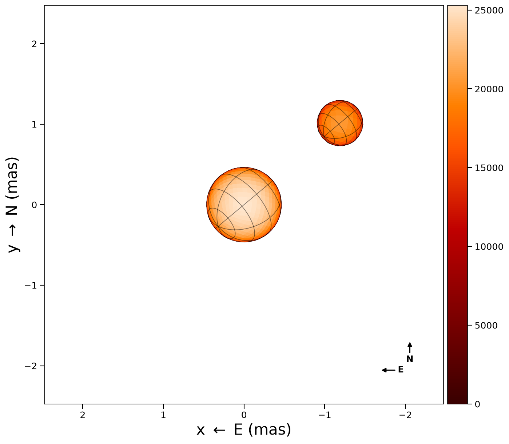

# ROTIR: Regularized Imaging of Stellar Surfaces

|     **Status**                  | **Documentation**               | **License**                     |**Build**                      |
|:--------------------------------|:--------------------------------|:--------------------------------|:------------------------------|
| [![][proj-img]][proj-url] | [![][doc-dev-img]][doc-dev-url] | [![][license-img]][license-url] | [![][build-img]][build-url] |

[proj-img]: http://www.repostatus.org/badges/latest/active.svg
[proj-url]: http://www.repostatus.org/#active

[doc-dev-img]: https://img.shields.io/badge/docs-dev-blue.svg
[doc-dev-url]: https://fabienbaron.github.io/ROTIR.jl/dev

[license-url]: ./LICENSE
[license-img]: http://img.shields.io/badge/license-GPL3-brightgreen.svg?style=flat

[build-img]: https://github.com/fabienbaron/ROTIR.jl/workflows/Documentation/badge.svg
[build-url]: https://github.com/fabienbaron/ROTIR.jl/actions

ROTIR is a Julia package for regularized imaging of stellar surfaces from
optical interferometry data, developed by Prof. Fabien Baron (Georgia State
University) and collaborators. It reconstructs temperature maps on tessellated
stellar surfaces by fitting interferometric observables (V², closure phases,
triple amplitudes).

### **[:book: Full Documentation](https://fabienbaron.github.io/ROTIR.jl/dev)**

## Installation

```julia
using Pkg
pkg"registry add General"
pkg"registry add https://github.com/emmt/EmmtRegistry"
Pkg.add(url="https://github.com/fabienbaron/OITOOLS.jl.git")
Pkg.add(url="https://github.com/fabienbaron/ROTIR.jl.git")
using ROTIR
```

See the [installation guide](https://fabienbaron.github.io/ROTIR.jl/dev/install/) for details.

### Optional packages

`using ROTIR` loads no plotting package, no Qt, no sampler and no Python. Optional features are
package extensions, active once their trigger packages are loaded:

| Load | Enables |
|------|---------|
| `Makie` | `plot2d_makie`, `plot3d_makie`, `plot_mollweide_makie`, the decorations |
| `GLMakie, QMLMakie, QML` | the GUI (`rotirgui`, `gui`) |
| `PythonPlot` | the matplotlib plots (`plot2d`, `plot3d`, …) |
| `Zygote` | `fit_parametric`, `bootstrap_parametric`, the gradient fit |
| `AdvancedHMC, LogDensityProblems` | `method = :nuts` |
| `Nautilus` | `method = :nautilus` (nested sampling, with evidence) |
| `Pigeons, Distributions, ADTypes` | `method = :pigeons` (parallel tempering) |
| `PythonCall` | `method = :ultranest` |
| `LoopVectorization` | `POLYFT_BACKEND[] = :turbo` (vectorised exact kernel) |

Each must be installed in your own project; `rotirgui()` offers to install the ones the window
needs. Calling a function whose extension is not loaded raises a `MethodError`.
`nautilus_available()`, `hmc_available()`, `pigeons_available()`, `ultranest_available()` and
`turbo_available()` report whether an extension is loaded.

Loading PythonCall, Pigeons or LoopVectorization invalidates precompiled plotting code: GUI
startup takes about 2 s longer with each.

## Quick start

```julia
using ROTIR

# data_all[wavelength_bin, epoch]
data_all = readoifits_multiepochs(["epoch1.oifits", "epoch2.oifits"])

data = data_all[1, :]

tepochs = [d.mean_mjd for d in data] .- data[1].mean_mjd   # days

# HEALPix level 3: nside = 8, 768 pixels
tessels = tessellation_healpix(3)

star_params = (
    surface_type=2,           # 0=sphere, 1=ellipsoid, 2=rapid rotator, 3=Roche lobe
    rpole=1.37,               # polar radius in milliarcseconds
    tpole=4800.0,             # polar temperature in Kelvin
    ldtype=3, ld1=0.23, ld2=0.0,  # Hestroffer power-law limb darkening
    inclination=78.0,         # inclination in degrees (90°=edge-on)
    position_angle=24.0,      # position angle of rotation axis on sky (degrees)
    rotation_period=54.8,     # rotation period in days
    beta=0.08,                # gravity darkening, T ∝ g^β
    frac_escapevel=0.9,       # Ω / Ω_crit
    B_rot=0.0,                # differential rotation (0 = solid body)
)

# Geometry, projection and visibility at each epoch
stars = create_star_multiepochs(tessels, star_params, tepochs)

# Starting map: the gravity-darkened temperature
tmap_start = parametric_temperature_map(star_params, stars[1])

# Fourier transform setup, stored in each star
setup_oi!(data, stars)

# "tv2": squared graph Laplacian, weight 1e-5, every pixel
regularizers = [["tv2", 1e-5, tv_neighbors_healpix(3), 1:length(tmap_start)]]

tmap = image_reconstruct_oi(tmap_start, data, stars;
                             maxiter=500, regularizers=regularizers)

# The visible disk at each epoch
plot2d_allepochs(tmap, stars)

# Scale the map so the pole temperature is star_params.tpole
tmap = rescale_temperature_tpole(tmap, stars, star_params)

# One epoch, with temperature contours
plot2d(tmap, stars[1];
    intensity=true, graticules=true, compass=true,
    contours=[4200, 4400, 4600, 4800],
    star_params=star_params)

# Whole surface, Mollweide projection; never-visible pixels greyed
plot_mollweide(tmap, stars[1], visible_pixels=sometimes_visible(stars))
```

## Gallery

| Sphere | Rapid Rotator |
|:------:|:-------------:|
|  |  |

| Roche lobe | Binary system |
|:--------------:|:--------------------:|
|  |  |

| Temperature contours | Mollweide projection |
|:--------------------:|:--------------------:|
|  |  |

See the [full documentation](https://fabienbaron.github.io/ROTIR.jl/dev/guides/surfaces/) for all surface types and plotting options.

## Features

- Surface geometries: sphere, triaxial ellipsoid, rapid rotator (Roche potential of a rotating
  star), Roche-lobe-filling binary component
- Binaries: Keplerian orbits, radial velocities, combined interferometric observables
- Tessellations: nested HEALPix and longitude/latitude grids
- Multi-epoch reconstruction across rotation phases
- Coarse-to-fine HEALPix reconstruction
- Joint fit of shape (radii, inclination, position angle) and surface map, with analytic gradients
- Matrix-free polygon Fourier transform: O(Nuv + Npix) memory
- Regularisers: `tv`, `tv2`, `mem`, `mean`, `bias`, `sobel`, `sobel2`, `laplace_beltrami`,
  `radflat`, `radialvar`, `orthold`
- VMLMB bounded quasi-Newton optimiser (OptimPackNextGen)
- Parametric fits: NLopt, NUTS, nested sampling (Nautilus, UltraNest), parallel tempering
  (Pigeons)
- Spots with flat or linear temperature profiles
- Plots: sky projections with graticules, contours and rotation marks; 3-D view; Mollweide maps
  with unobserved pixels masked

ROTIR uses [OITOOLS.jl](https://github.com/fabienbaron/OITOOLS.jl) to read and handle OIFITS
data.

## Graphical interface (work in progress)

```julia
using ROTIR
rotirgui()                             # empty session
rotirgui("mydata.oifits")              # one dataset
rotirgui("ep1.oifits", "ep2.oifits")   # several epochs
```

`rotirgui` sets the OpenGL and Qt environment, loads GLMakie, QMLMakie, QML and the optional
samplers, and opens the window. If GLMakie, QMLMakie or QML are missing it offers to install
them; Enter installs only those. `install = true` installs everything without asking,
`install = false` stops with instructions, `samplers = false` skips the optional samplers
(faster startup, fewer fit methods).

With the packages already loaded, `gui()` opens the window:

```julia
using ROTIR, GLMakie, QMLMakie, QML
gui()                                 # or gui(session)
```

From a clone, with a pinned environment:

```
julia --project=bin bin/rotirgui.jl [file.oifits ...]
```

Tabs:

- **Explore**: epochs, OITOOLS filtering, observable plots (per baseline, against the model or
  the reconstruction, residuals), point selection and removal, OIFITS export, reduced χ² per
  epoch.
- **Model**: parameter form for the chosen surface type; each parameter free, fixed or tied;
  fits with VMLMB, Nelder–Mead, BOBYQA, NUTS, Nautilus, Pigeons or ESS.
- **Imaging**: tessellation, regularisers, reconstruction.
- **Orbit**: binary orbit and orbit fits.

Model and Imaging share three views: sky projection, 3-D, and Mollweide.

Fits and reconstructions run on a worker thread; their trace streams to the console panel.
Each action prints the equivalent ROTIR call. **Export script…** writes the session as a
runnable `.jl`. **Save model map** writes the HEALPix map to FITS with the keywords needed to
reproduce its χ²; **Load model map** reads one.

## Documentation

[fabienbaron.github.io/ROTIR.jl](https://fabienbaron.github.io/ROTIR.jl/dev):

- [Overview and workflow](https://fabienbaron.github.io/ROTIR.jl/dev/guides/overview/)
- [Tessellation schemes](https://fabienbaron.github.io/ROTIR.jl/dev/guides/tessellation/)
- [Surface types](https://fabienbaron.github.io/ROTIR.jl/dev/guides/surfaces/)
- [Plotting and visualization](https://fabienbaron.github.io/ROTIR.jl/dev/guides/plotting/)
- [Binary stars and orbits](https://fabienbaron.github.io/ROTIR.jl/dev/guides/orbits/)
- [Image reconstruction](https://fabienbaron.github.io/ROTIR.jl/dev/guides/reconstruction/)
- [Multi-resolution imaging](https://fabienbaron.github.io/ROTIR.jl/dev/guides/multires/)
- [Conventions](https://fabienbaron.github.io/ROTIR.jl/dev/guides/conventions/)
- [API reference](https://fabienbaron.github.io/ROTIR.jl/dev/api/chi2/)

## Development install

```julia
using Pkg
pkg"registry add General"
pkg"registry add https://github.com/emmt/EmmtRegistry"
Pkg.develop(url="https://github.com/fabienbaron/ROTIR.jl.git")
```
