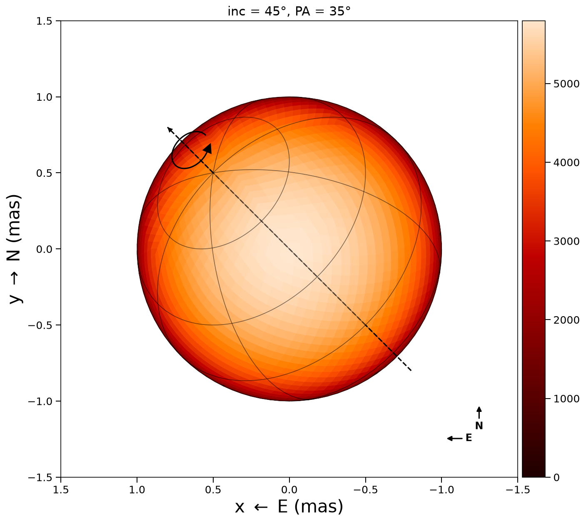

# Conventions

Coordinate systems, angles and signs used by the geometry, orbit, radial-velocity and
plotting code.

## Sky plane

Astronomical sky-plane convention:

| Axis | Direction | Internal name |
|------|-----------|---------------|
| x | East (left on plots) | `-proj_west` |
| y | North (up on plots) | `proj_north` |
| z | toward the observer | `normal_z > 0` is visible |

Projected vertices are stored as `proj_west` and `proj_north`, in mas. Plots negate the West
component so East is on the left.

## Stellar surface coordinates

The unit sphere uses spherical coordinates:

| Coordinate | Symbol | Range | Definition |
|------------|--------|-------|------------|
| Colatitude | θ | 0 to π | from the North pole |
| Longitude  | φ | 0 to 2π | increasing eastward |

Cartesian: `x = sin(θ)cos(φ)`, `y = sin(θ)sin(φ)`,
`z = cos(θ)`.

## Spin-axis angles

### Inclination

Angle between the spin axis and the line of sight (+z, toward the observer).

| Value | Meaning |
|-------|---------|
| 0° | pole-on |
| 90° | equator-on |

### Position angle (PA)

Angle of the projected spin axis on the sky, from North through East (counterclockwise on
plots).

| Value | Projected pole points ... |
|-------|---------------------------|
| 0° | North |
| 90° | East |

Spin-axis direction:

```
spin_x = -sin(inc) sin(PA)   (West component)
spin_y =  sin(inc) cos(PA)   (North component)
spin_z =  cos(inc)           (toward observer)
```

## Rotation matrix

ZXZ Euler angles, applied as a right multiplication of the vertex coordinates:

```
xyz_rotated = xyz · R(ψ, inc, PA)
```

where `R = Rz(-ψ) · Rx(inc) · Rz(-PA)` and the angles are:

| Angle | Symbol | Meaning |
|-------|--------|---------|
| ψ | `2π (t − t0) / rotation_period` | rotation phase |
| inc | `inclination` (degrees in `star_params`) | tilt from the line of sight |
| PA | `position_angle` (degrees in `star_params`) | orientation on the sky |

Rotation is counterclockwise on sky plots seen from the visible pole: a surface feature moves
West → North → East as time increases. (`rot_vertex` in `src/geometry.jl`.)

## Rotation sense

Stellar spin and orbital motion have the same sense: counterclockwise on the sky when the
angular momentum points toward the observer.

| Motion | Face-on (inc or i = 0°) | On sky (East left, North up) |
|--------|------------------------|------------------------------|
| Stellar spin | Feature: West → North → East | Counterclockwise |
| Orbital (increasing ν) | Secondary: North → East → South | Counterclockwise |

A spin feature at `(West=1, North=0)` at `t=0` is at `(West=0, North=1)` at `t=P/4`; a
secondary at `(North=1, East=0)` at `ν=0` is at `(North=0, East=1)` at `ν=π/2`.

## Rotation phase and the epoch `t0`

The surface spins at

```math
\psi = 2\pi\,(t - t_0) / P_\mathrm{rot}
```

with `t0` and `rotation_period` in the units of the epochs. `t0` defaults to `0`.

### What `ψ = 0` means on the surface

* The sub-observer longitude is 270° at `ψ = 0` and decreases with phase:

  ```math
  \lambda_\mathrm{sub-obs} = 270° - 360°\,(t - t_0)/P_\mathrm{rot}
  ```

  where longitude is `atan2(y, x)` of the body-frame tessel centre, in `[0°, 360°)`;

* The body +x axis lies in the plane of the sky. For `surface_type = 1` that axis is
  `radius_x`, so for a prolate (tidally distorted) figure `ψ = 0` is a maximum-elongation
  phase.

### Setting `t0` from a published ephemeris

For a tidally locked binary the long axis points at the companion:

| At `t = t0` | |
|---|---|
| long axis | in the plane of the sky |
| orbital position | nodal passage |
| projected area | maximum |
| ellipsoidal light curve | maximum |

A published time of nodal passage (a maximum of the ellipsoidal light curve) can be used as
`t0`; the map is then in that paper's longitude system.

!!! note "Two nodal passages per orbit"
    A prolate silhouette repeats every half rotation: the long axis is in the plane of the
    sky at `ψ = 0` and at `ψ = 0.5`. Which end of the tidal axis faces the companion
    (ascending or descending node) is set by the ephemeris's definition. If it is unknown,
    `t0` is ambiguous by half a period; resolve it with the surface map or the radial
    velocities.

!!! warning "`t0` here is not the orbital `T0`"
    The orbital `T0` (`ORBIT_ELEMENTS`, `src/orbits.jl`) is the time of periastron:
    `M = n·(t − T0)`. A circular-orbit spectroscopic ephemeris quotes a nodal passage
    instead; the two are not interchangeable. The surface `t0` is the rotation phase zero,
    independent of both.

### Worked example: ζ And

Roettenbacher et al. give `P = 17.769426 d` and a time of nodal passage
`T0 = MJD 49992.281` from the ellipsoidal light curve. With their published map and geometry,
and the six 2019 epochs as MJD:

| surface `t0` | χ²/n |
|---|---|
| `T0` | 19.34 |
| `T0 + P/2` | 2.11 |
| best over a scan of the full period | 2.11, at `T0 + 0.500 P` |

Their `T0` is the other node, `ψ = 0.5` in ROTIR's convention. Use

```julia
t0 = 49992.281 + 17.769426/2        # their T0 is the opposite nodal passage
```

with unshifted MJD epochs. `demos/zetand_surfing_conventions.jl` prints the table;
`demos/zetand_joint_map.jl` measures the remaining longitude offset between a ROTIR
reconstruction and theirs.

## Visibility

A surface element is visible when its outward normal has `z > 0`. The mask is soft:

```
weight = sigmoid(κ · normal_z)
```

`κ` sets the sharpness of the limb transition (`create_star(…; κ = 50)`). Pixels with
`weight ≤ 0.01` are dropped.

## Binary orbital elements

Standard astrometric and spectroscopic conventions:

| Parameter | Symbol | Unit | Definition |
|-----------|--------|------|------------|
| Orbital inclination | `i` | degrees | between orbital angular momentum and line of sight (0° face-on, 90° edge-on) |
| Longitude of ascending node | `Ω` | degrees | position angle of the ascending node, N through E |
| Argument of periapsis | `ω` | degrees | from ascending node to periapsis, in the orbital plane, for the relative orbit (secondary); the primary's is `ω + π` |
| Period | `P` | days | |
| Semi-major axis | `a` | mas | |
| Eccentricity | `e` | | |
| Time of periapsis | `T0` | days | same time system as the epochs |
| Mass ratio | `q` | | M₂ / M₁ |
| Period derivative | `dP` | days/day | |
| Apsidal motion | `dω` | degrees/day | positive in the direction of orbital motion |

`compute_coeff()` computes the Thiele–Innes coefficients from `(Ω, i, ω)`.

### Orbital output frame

`binary_orbit_rel` and `binary_orbit_abs` return positions in the observer frame:

| Component | Direction |
|-----------|-----------|
| x | North (Dec increasing) |
| y | East (RA increasing) |
| z | away from the observer (positive = receding) |

The orbital z axis points away from the observer; the stellar-geometry z axis points toward
it. `orbit_to_rotir_offset` converts the orbital position to the sky-plane offset:

```
offset_west  = -(East component)    # West = -East
offset_north =   North component
```

## Radial velocities

`binary_RV` returns radial velocities in the units of `K1`, `K2` and `γ` (km/s by
convention):

| Sign | Meaning |
|------|---------|
| positive | receding |
| negative | approaching |

```
Vrad = γ + K [cos(ν + ω) + e cos(ω)]
```

where `ν` is the true anomaly. The secondary uses `ω`, the primary `ω + π`.

## Annotated example

A sphere at inclination 45° and position angle 45°, with spin axis, rotation arrow,
graticules and compass:


