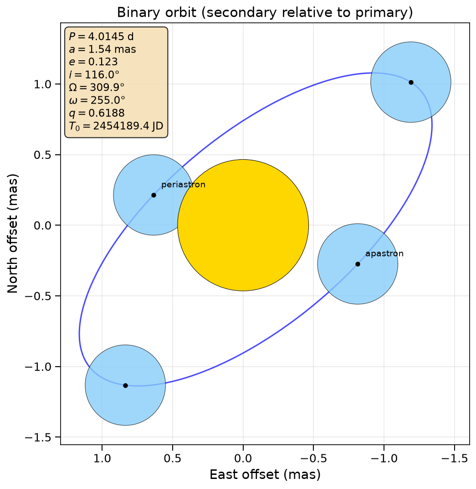
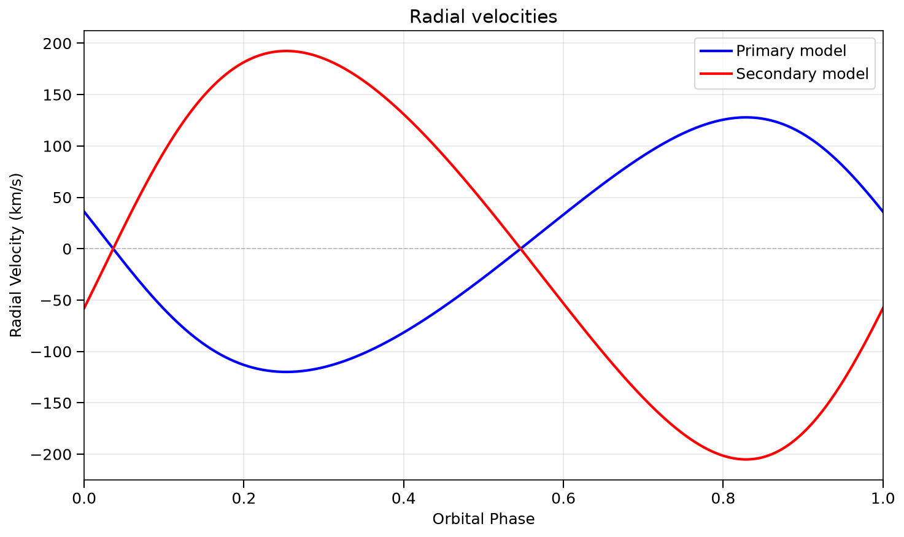
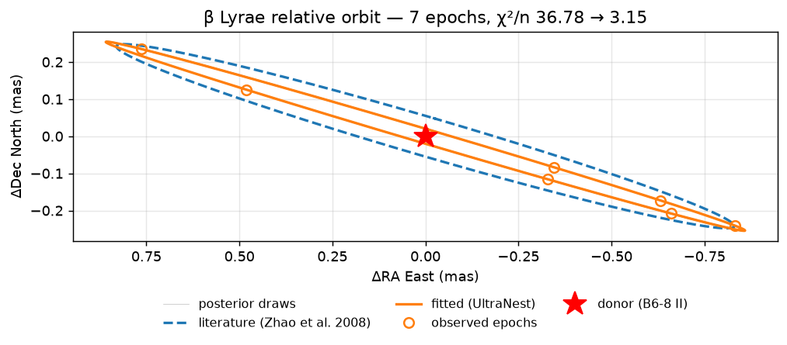
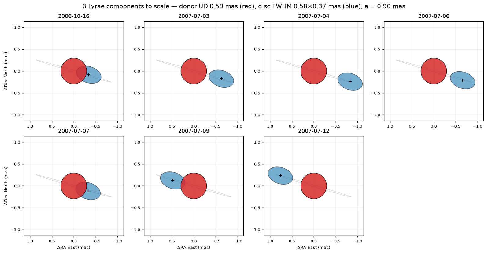

# Binary Orbits

Binary systems with one or both components resolved: orbital elements, positions, radial
velocities, plots, and orbit fits.

## Orbital elements

A binary is a `binaryparameters` NamedTuple holding two `starparameters` NamedTuples and the
orbital elements:

```julia
using ROTIR

# Spica-like binary (Aufdenberg+2015)
star1 = starparameters(
    0.465,    # rpole: polar radius (mas)
    25300.0,  # tpole: polar temperature (K)
    0.0,      # frac_escapevel
    3,        # ldtype: Hestroffer limb darkening
    0.15,     # ld1
    0.0,      # ld2 (unused for Hestroffer)
    0.25,     # beta: von Zeipel exponent (radiative)
    0.0,      # B_rot: differential rotation
    64.0,     # inclination (degrees)
    129.938,  # position_angle (degrees)
    0.0,      # rotation_offset (degrees)
    4.0145,   # rotation_period (days)
)
star2 = starparameters(
    0.285, 20585.0, 0.0, 3, 0.15, 0.0, 0.25, 0.0, 64.0, 129.938, 0.0, 4.0145)

bparams = binaryparameters(
    star1, star2,
    77.0,          # d: distance (pc)
    116.0,         # i: orbital inclination (degrees; >90 = retrograde)
    309.938,       # Ω: longitude of ascending node (degrees)
    255.0,         # ω: argument of periapsis (degrees, relative orbit)
    4.0145,        # P: orbital period (days)
    1.54,          # a: semi-major axis (mas)
    0.123,         # e: eccentricity
    2454189.40,    # T0: time of periastron (JD)
    0.6188,        # q: mass ratio M₂/M₁
    [1.0, 1.0],    # fillout_factor (unused for spheres)
    0.0,           # dP: period derivative (days/day)
    0.0,           # dω: apsidal motion (degrees/day)
)
```

Both are plain NamedTuples, so they can also be written directly:

```julia
star1 = (rpole=0.465, tpole=25300.0, frac_escapevel=0.0, ldtype=3,
         ld1=0.15, ld2=0.0, beta=0.25, B_rot=0.0,
         inclination=64.0, position_angle=129.938,
         rotation_offset=0.0, rotation_period=4.0145)
```

and modified with `merge`:

```julia
star1_tilted = merge(star1, (inclination=75.0, position_angle=140.0))
bparams_circ = merge(bparams, (e=0.0,))
```

[Conventions](conventions.md#binary-orbital-elements) describes each parameter and the
coordinate frame.

## Orbital positions

```julia
# Secondary relative to primary: returns (0, 0, 0, x, y, z)
x1, y1, z1, x2, y2, z2 = binary_orbit_rel(bparams, tepoch_jd)

# Both components relative to the centre of mass
x1, y1, z1, x2, y2, z2 = binary_orbit_abs(bparams, tepoch_jd)

# Projected position, separation ρ and angle θ (radians) at several epochs
x, y, ρ, θ = binary_proj_plane(bparams, tepochs_jd)

# Separation in units of a
D = compute_separation(bparams, tepoch_jd)
```

Times are JD. The output frame is x = North, y = East, z = along the line of sight (positive
receding). `orbit_to_rotir_offset` converts to ROTIR's (West, North) frame.

## Orbit plot



The secondary's orbit (blue) relative to the primary (gold), on the sky. East is left.

## Sky-plane image

`plot2d_binary` draws both components at one epoch:

```julia
# create_star takes reconstruction-style NamedTuples (surface_type, ...)
star1_params = (surface_type=0, radius=star1.rpole, tpole=star1.tpole,
                ldtype=star1.ldtype, ld1=star1.ld1, ld2=star1.ld2,
                inclination=star1.inclination, position_angle=star1.position_angle,
                rotation_period=star1.rotation_period)
star2_params = (surface_type=0, radius=star2.rpole, tpole=star2.tpole,
                ldtype=star2.ldtype, ld1=star2.ld1, ld2=star2.ld2,
                inclination=star2.inclination, position_angle=star2.position_angle,
                rotation_period=star2.rotation_period)

tessels1 = tessellation_healpix(3)
tessels2 = tessellation_healpix(2)
star1_geom = create_star(tessels1, star1_params, 0.0)
star2_geom = create_star(tessels2, star2_params, 0.0)
tmap1 = parametric_temperature_map(star1_params, star1_geom)
tmap2 = parametric_temperature_map(star2_params, star2_geom)

fig, ax = plot2d_binary(tmap1, tmap2, star1_geom, star2_geom, bparams, tepoch_jd;
    intensity=true, graticules=true, compass=true,
    inclination1=64.0, position_angle1=129.938,
    inclination2=64.0, position_angle2=129.938)
```

The secondary is placed at its orbital offset, and the farther star is drawn behind the
nearer one.


## Radial velocities

`binary_RV` computes both components' radial velocities from the semi-amplitudes K₁, K₂ and
the systemic velocity γ (km/s). Positive is receding.

```julia
rv1, rv2 = binary_RV(bparams, tepochs_jd; K1=123.9, K2=198.8, γ=0.0)

fig, ax = plot_rv(bparams; K1=123.9, K2=198.8, γ=0.0,
    rv_data1=data_rv1, rv_data2=data_rv2)    # data optional
```

`tepochs_jd` is a `Float64` or a `Vector{Float64}`.



## Interferometric forward model

The binary complex visibility combines both components, the secondary shifted by the
orbital separation:

```julia
offset_x, offset_y = orbit_to_rotir_offset(bparams, tepoch_jd)   # (West, North), mas
phase = binary_phase_shift(data.uv, offset_x, offset_y)
v2, t3amp, t3phi = binary_observables(tmap1, star1, tmap2, star2, data, phase)
chi2 = binary_chi2_f(tmap1, star1, tmap2, star2, data, phase)
```

Mutual occultation is off by default; `occultation = true` (or `:exact`, `:soft`) turns it
on in `binary_cvis`, `binary_observables` and the χ² functions.

## Two stars in one frame

The phase shift above places the secondary but does not orient either component in 3-D.
Tidally distorted (Roche) components and mutual irradiation need both in one frame, with the
tidal bulge pointing at the companion. [`create_binary_geometry`](../api/binary_geometry.md)
builds that frame from the orbit:

```julia
star1, star2 = create_binary_geometry(tes1, params1, tes2, params2, bparams, tepoch_jd;
                                      volume_conserving=true)
tmap1 = parametric_temperature_map(params1, star1)
tmap2 = parametric_temperature_map(params2, star2; secondary=true)
heated1, heated2 = handle_reflection(star1, tmap1, star2, tmap2; albedo1=0.6, albedo2=0.6)
```

Calling `create_star` twice is not equivalent: its `t` sets both the Roche shape (through
`D(t)`) and the spin phase, with nothing aligning the bulge to the line of centres. Real epoch
times rotate the star without its bulge; `t = 0` freezes both.

[`check_binary_overlap`](../api/binary_geometry.md) reports epochs at which the two disks
overlap on the sky.

## Fitting orbital elements to interferometric data

The elements are fitted directly to the OIFITS data, without intermediate per-epoch
astrometry:

```
(orbital elements, component sizes) → separation at each observation
    → component visibilities → combined complex visibility → observables → one χ²
```

The likelihood uses the OIFITS errors on V², T3amp and T3φ over the whole dataset.

Example scripts:

| Script | System | Sampler |
|---|---|---|
| `demos/spica_orbit_fit_ultranest.jl` | Spica: two uniform discs, eccentric orbit | UltraNest |
| `demos/betlyr/betlyr_orbit_fit_ultranest.jl` | β Lyrae: donor + accretion disc, circular orbit | UltraNest |
| `demos/betlyr/betlyr_orbit_fit_pigeons.jl` | β Lyrae, same model | Pigeons |
| `demos/betlyr/betlyr_orbit_figure.jl` | β Lyrae: redraws the orbit from a stored fit | none |

The β Lyr model is in `demos/betlyr/betlyr_model.jl`, included by both drivers. The result
is in [Worked example: β Lyrae](@ref).

### Sampling

These posteriors are multimodal. A scan over Spica's (ω, dω) alone runs from χ²/n = 73 to
232, with a degeneracy valley whose preferred sign of dω flips with ω. A local optimiser
returns the basin it starts in.

### Analytic components for the orbit

Fit the orbit with analytic components (uniform discs, elliptical Gaussians), then pass it
to a tessellated model. A tessellated χ² costs about 0.2–2 s per likelihood, the analytic
one 0.2–0.3 ms; the surface detail changes the separation by a few percent.

```julia
const MAS_PER_RAD = 206264806.2
ud_vis(diam, ρ) = (t = diam / MAS_PER_RAD * pi .* ρ .+ 1e-10; 2 .* besselj1.(t) ./ t)
```

OITOOLS' model API (`dict_to_model`, `model_to_vis`, re-exported by ROTIR) provides the
standard component visibilities.

### Per-observation times

Evaluate the orbit at each observation's MJD, not one mean time per night. Spica's 2015
nights span about 4.7 h, during which the secondary moves 0.24–0.52 mas and the position
angle changes by 8–38°, ten times the astrometric precision.

- With `Float32` data, `uv_mjd` quantises MJD ≈ 57131 to about 5.6 minutes. Take per-uv
  times from the `Float64` `v2_mjd`/`t3_mjd` through `indx_v2` / `indx_t3_1,2,3`.
- Many uv points share a time (one exposure, many baselines). Solving Kepler's equation once
  per distinct time and broadcasting back takes 17× fewer solves for Spica, 26× for β Lyrae.

### The (Ω, ω) degeneracy

Under `(Ω, ω) → (Ω+180°, ω+180°)` every Thiele–Innes constant is unchanged, so the
separation and every interferometric observable are invariant. Sampling the full range gives
a bimodal posterior; restrict Ω to `[0°, 180°)`.

- The fold applies to the pair. Moving Ω alone mirrors the position vector, which changes
  the sign of the closure phases; for Spica χ²ₜ₃ₚ/n went from 291 to 811.
- For a circular orbit ω is degenerate with T₀, and the degeneracy becomes
  `(Ω, T₀) → (Ω+180°, T₀ + P/2)`. Fix ω, restrict Ω, and let T₀ span a full period.

### Samplers

**UltraNest** (`ultranest` through PythonCall) returns log Z and needs no tuning. Vectorise
it, as OITOOLS' `fit_model_ultranest` does, so the Julia–Python crossing happens once per
batch:

```julia
prior_v(U::AbstractMatrix{<:Real}) =
    Py(reduce(vcat, (u -> prior_1(u)').(eachrow(U)))).to_numpy()
loglike_v(X::AbstractMatrix{<:Real}) = Py(loglike_1.(eachrow(X))).to_numpy()
sampler = ultranest.ReactiveNestedSampler(pylist(names), loglike_v;
                                          transform = prior_v, vectorized = true)
```

- `::AbstractMatrix{<:Real}` makes PythonCall convert the numpy batch to a Julia matrix.
  Without it the argument stays a `Py` and `collect` raises
  `MethodError: no method matching (Array{Float64})(::Py)`.
- `.to_numpy()` is required on the return values: UltraNest calls numpy methods
  (`.transpose`) on them, which a `juliacall.VectorValue` lacks.
- `names` must be a `pylist`: UltraNest evaluates `names + [...]`, which a `VectorValue`
  does not support.

!!! note "Threading and UltraNest"
    A multithreaded session works: PythonCall's finalizer queues the pointer, and only a
    thread holding the GIL drains the queue (`PyGILState_Check`, `PythonCall/src/GC/GC.jl`),
    so `Py` objects may be finalized on any thread. A full UltraNest run completes under
    `julia -t 8`.

    Python may only be called from a thread holding the GIL. Calling Python inside a
    `Threads.@threads` body without `PythonCall.GIL.@lock` segfaults, so a likelihood that
    calls Python must run single-threaded; a pure-Julia likelihood may run threaded.

**Pigeons** (`Pigeons.jl`, pure Julia) uses several cores, returns log Z by stepping stone,
and reports round trips between reference and target. On the β Lyr fit, 8 chains × 32
scans:

| | wall |
|---|---|
| `multithreaded = true` | 35.8 s |
| `multithreaded = false` | 139.8 s |

The speed-up is bounded by `n_chains` (`N_CHAINS` in the demo), not by the core count.

Sample in an unconstrained space, `θ = lo + (hi−lo)·σ(z)`, with a plain wide Gaussian
reference, and include the log-Jacobian so that a uniform box prior stays uniform
(`z_to_theta`, `log_jacobian`, `theta_to_z` in `betlyr_model.jl`).

PythonCall defers decrefs until a thread holds the GIL, so `Py` objects (from PythonPlot,
for example) may exist during a Pigeons run.

Check `Pigeons.n_round_trips(pt)` before using an interval. Zero round trips means the chain
never travelled between reference and target.

### Monitoring a Pigeons run

Pigeons has no per-scan callback. It runs in doubling rounds (round `r` is `2^r` scans) and
adapts between rounds. Running one round at a time gives the same log Z, round-trip count and
traces as a single `n_rounds = N` call:

```julia
pt = pigeons(; kw..., n_rounds = 1, show_report = false)
report_round!(pt, 1)
for r in 2:N_ROUNDS
    global pt = pigeons(Pigeons.increment_n_rounds!(pt, 1))
    report_round!(pt, r)
end
```

Report a summary of the round's trace (a median over `Pigeons.get_sample(pt)`), not the
latest state. `betlyr_orbit_fit_pigeons.jl` does this with `VERBOSE=1`.

### Gradients

The orbit forward model is differentiable, Kepler's equation included. `kepler_E` has an
analytic `rrule`/`frule` from the implicit function theorem:

```
M = E − e·sin E   ⇒   ∂E/∂M = 1/(1 − e·cos E),   ∂E/∂e = sin E/(1 − e·cos E)
```

It is exact at the converged root and costs two trig calls. `1 − e·cos E = r/a > 0`, so it is
never singular on an ellipse.

A differentiable likelihood also needs:

1. No array mutation: Zygote rejects `setindex!`. Use broadcasts or comprehensions
   (`z_to_theta_ad` in the β Lyr demo).
2. Vectorisation over epochs: use `orbit_to_rotir_offset(bparams, tepochs::AbstractVector)`.
   Looping the scalar method costs 512× the primal in reverse mode for 55 epochs; the
   vectorised method is also about 6× faster in the primal.
3. Type stability: OITOOLS declares `OIdata`'s data fields as
   `Vector{T} where T<:AbstractFloat`, so `d.v2` is not inferable. Copy what the likelihood
   needs into concrete `Vector{Float64}` constants at load time.
   `JET.@report_opt chi2_total(θ)` should report no runtime dispatch.

On the β Lyr fit (10 free parameters, χ² = 0.42 ms), all agreeing to 1e-12 with
`central_fdm(5, 1)`:

| method | cost | note |
|---|---|---|
| ForwardDiff | 8.1× primal | fastest at this dimension |
| Zygote (reverse) | 10.9× | faster than forward mode above ~25 parameters |
| central differences | 20× (`2n` evals) | scales with `n` |
| `central_fdm(5, 1)` | 40× (`4n` evals) | scales with `n` |

!!! note "Finite differences on an orbit"
    `central_fdm`'s adaptive step can push `dP` (~6e-7 d/d) to O(1e-2), which triggers the
    quadratic-ephemeris warning. Pass a per-parameter `max_range`. `T0` needs a large step:
    at ~2.45e6 JD a 1e-6 step leaves about 4 significant digits.

Slice sampling costs about 765 likelihood evaluations per chain-scan at this dimension
(3 passes × 10 coordinates × ~25 steps). Compare `n_round_trips` with `EXPLORER=slice` and
`EXPLORER=mala` to decide whether a gradient explorer helps.

!!! warning "Eclipses and gradients"
    With occultation, use the `:soft` method of
    [`occultation_weights`](../api/binary_geometry.md): its sigmoid is C∞. The `:exact`
    Sutherland–Hodgman area is continuous and piecewise smooth. In a flat-disc model the
    near/far switch (which star is in front) is discontinuous, at conjunction, which in an
    eclipsing system is where the most informative data are.

### Worked example: β Lyrae

`demos/betlyr/betlyr_orbit_fit_ultranest.jl` on the 2006–2007 MIRC nights (`DATASET=old`,
the default), for comparison with the published elements. Model: uniform disc for the
B6–8 II donor, elliptical Gaussian for the accretion disc, circular orbit; 10 free
parameters, 1970 data points, 7 epochs.



The grey posterior draws (26268 samples) lie under the fitted curve.

`a` is 0.90 mas and the donor 0.59 mas across:



The components overlap on the sky at several epochs. The demo's `model_cvis` sums them with
a phase shift and no occultation term, so it double-counts the overlap there. By half-FWHM
the overlap affects 3 of 7 epochs (2006-10-16, 2007-07-07, 2007-07-09) and 45 % of the orbit,
with a minimum projected separation of 0.02 mas. Using the Gaussian's 2σ extent (0.49 mas),
only 2007-07-04 is free of overlap. The disc is in front in October and behind in July, so
the error changes sign between epochs.

Occulting a Gaussian is undefined; the disc needs a physical model first. Options: an opaque
donor and an optically thin disc, or an opaque elliptical disc with
[`occultation_weights`](../api/binary_geometry.md). Both lose the closed-form visibility and
require an image-plane model with NFFT.

Six of the seven epochs fall in nine days in July 2007.

| | literature | fitted | posterior sd |
|---|---|---|---|
| `a_mas` | 0.865 | 0.8958 | 0.00065 |
| `incl_deg` | 93.50 | 91.244 | 0.046 |
| `Omega_deg` | 73.70 | 73.529 | 0.040 |
| `T0_JD` | 2454283.043 | 2454283.0555 | 0.0017 |
| `P_d` | 12.9414 | 12.9616 | 0.0017 |
| `ud_donor_mas` | 0.570 | 0.5898 | 0.0032 |
| `disc_fwhm_mas` | 0.900 | 0.5825 | 0.0022 |
| `disc_ratio` | 0.6058 | 0.6423 | 0.0051 |
| `disc_pa_deg` | (73.70) | 108.353 | 0.224 |
| `f_disc` | 0.8065 | 0.8179 | 0.0031 |

Reduced χ² by observable:

| | literature | fitted |
|---|---|---|
| V² (858) | 9.46 | 1.47 |
| T3amp (556) | 7.85 | 1.57 |
| T3φ (556) | 107.85 | 7.33 |
| **total (1970)** | **36.78** | **3.15** |

- χ²ₜ₃ₚ/n falls by a factor 15. The closure phases constrain the asymmetry of the
  disc-plus-donor pair.
- `a`, `i`, `Ω` and `T0` are within a few percent of the published values (`Ω` within
  0.17°). The χ² improvement comes from the disc parameters.
- `disc_pa_deg` has no published value: 73.70 is `mod(253.7°, 180°)`, the starting value in
  `betlyr_params.jl`. In `ellgauss_vis`, `ratio` scales the rotated `up` frequency
  coordinate, so the source is narrower along `pa`: `disc_pa_deg` is the minor axis, the
  major axis is at `pa + 90°`, and `disc_fwhm_mas` is the major-axis FWHM. `φ` runs from +RA
  toward +Dec, so the astronomical PA (North through East) is `90° − φ`. The fitted major
  axis is at PA 71.65°, 1.9° from the line of nodes (73.53°), as expected for a coplanar
  disc.
- `disc_fwhm_mas` goes from 0.90 to 0.58. The elliptical Gaussian is the model's only
  freedom for asymmetric structure.
- The sd of `P_d` is the prior width: the data, spanning 269 d, carry almost no period
  information (see `PMAX` in `betlyr_model.jl`). The same holds for any parameter whose sd is
  close to its prior half-width.

!!! warning "The posterior sds are not uncertainties on the elements"
    Refitting the same ten parameters on subsets of the epochs moves them by tens of
    posterior sd. Dropping the three smallest-separation epochs shifts `T0` by −60σ and
    `disc_fwhm` by +45σ; dropping the three largest shifts `a` by +60σ and `Ω` by −33σ. With
    4 of 7 epochs the statistical error should grow only by ~√(7/4).

    The sds are the curvature of the likelihood under this model. The likely cause is the
    missing occultation term: the components overlap at 3 of 7 epochs by half-FWHM and at 6
    of 7 by the 2σ extent. Use the elements as a consistency check against Zhao et al.
    (2008), not as measurements with these error bars.

To redraw the figure and tables from the stored posterior without sampling:

```julia
julia --project=demos demos/betlyr/betlyr_orbit_figure.jl
```

## Fitting interferometry together with radial velocities

- RVs break the (Ω, ω) degeneracy, so Ω may span `[0°, 360°)`.
- K₁ and K₂ give `a·sin i` and `q`; with the angular `a` from interferometry they give
  dynamical masses and an orbital parallax.

`demos/spica_orbit_fit_ultranest.jl` with `USERV=1` adds K₁, K₂ and γ to the free parameters
and `chi2_rv` to the χ². The RV model is `binary_RV`, which includes apsidal motion through
`omega_at`.

```bash
USERV=1 LIVE=400 julia --project=demos demos/spica_orbit_fit_ultranest.jl
```

An RV depends on ω alone, so `(Ω,ω) → (Ω±180°, ω±180°)` inverts the RV curve. For Spica at
the literature starting point, χ²_RV is 8.1 per point on the correct branch and 586 on the
mirror.

### RV data

| System | RVs in the repository |
|---|---|
| Spica | `demos/data/all_rv_1_ORIG.txt`, `all_rv_2_ORIG.txt`: 33 + 33 points |
| β Lyrae | none |

The Spica RVs:

- span 48 days in 2000, about 7 years and 639 orbits before the interferometry, so a joint
  fit must include `dω` (or `dP` for systems like β Lyr);
- have a placeholder error column (every point 1.00 km/s), which would let the RV χ²
  outweigh the 6871 interferometric points;
- have separation-dependent residuals, from line blending in an SB2 with `v sin i` = 161 km/s:

  | \|V₂−V₁\| (km/s) | mean \|residual\| |
  |---|---|
  | 0–50 | 36.7 |
  | 100–200 | 21.8 |
  | 300–600 | 7.2 |

The demo therefore uses `σ(Δ) = 7 + 30·exp(−|Δ|/100)` km/s, which down-weights the blended
points. Removing them instead lowers the rms to 5.2 km/s but biases K₁ and K₂ by about 7% and
leaves ω unconstrained. Errors below ~5 km/s require spectral disentangling of the archival
spectra (Tkachenko et al. 2016).
