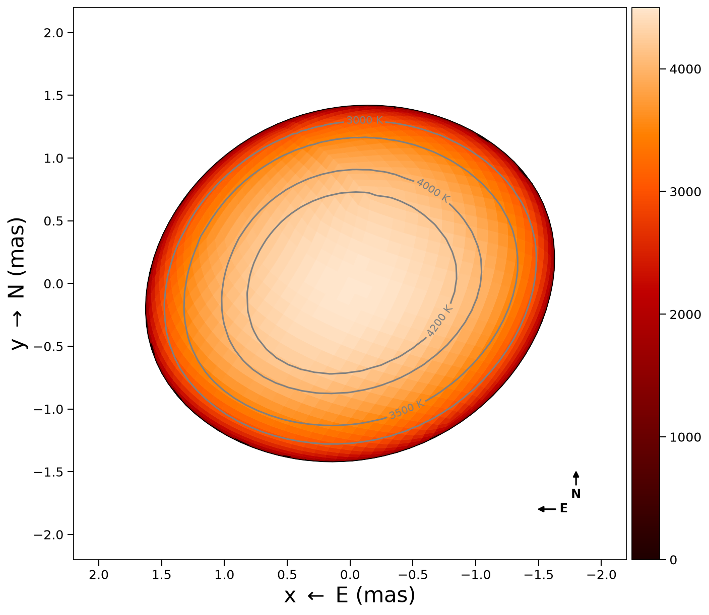
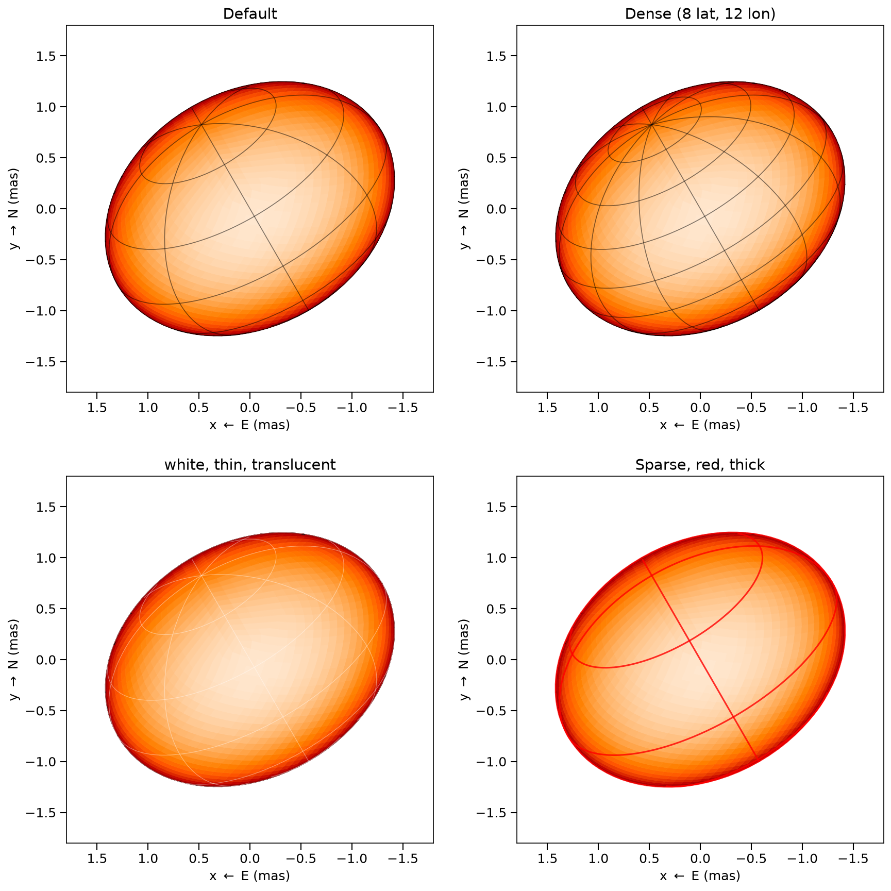
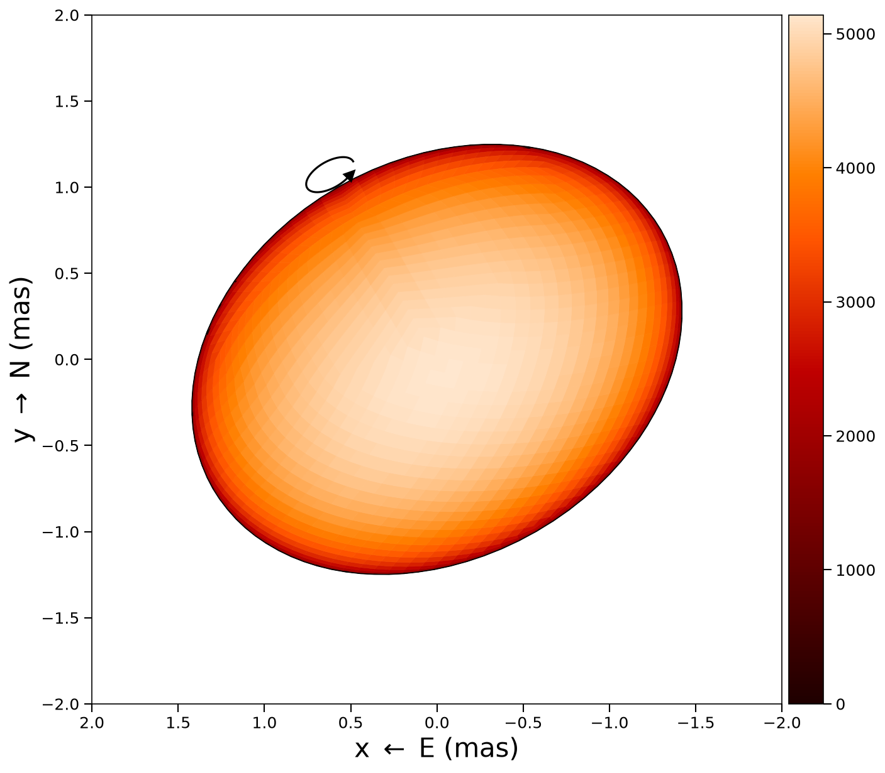
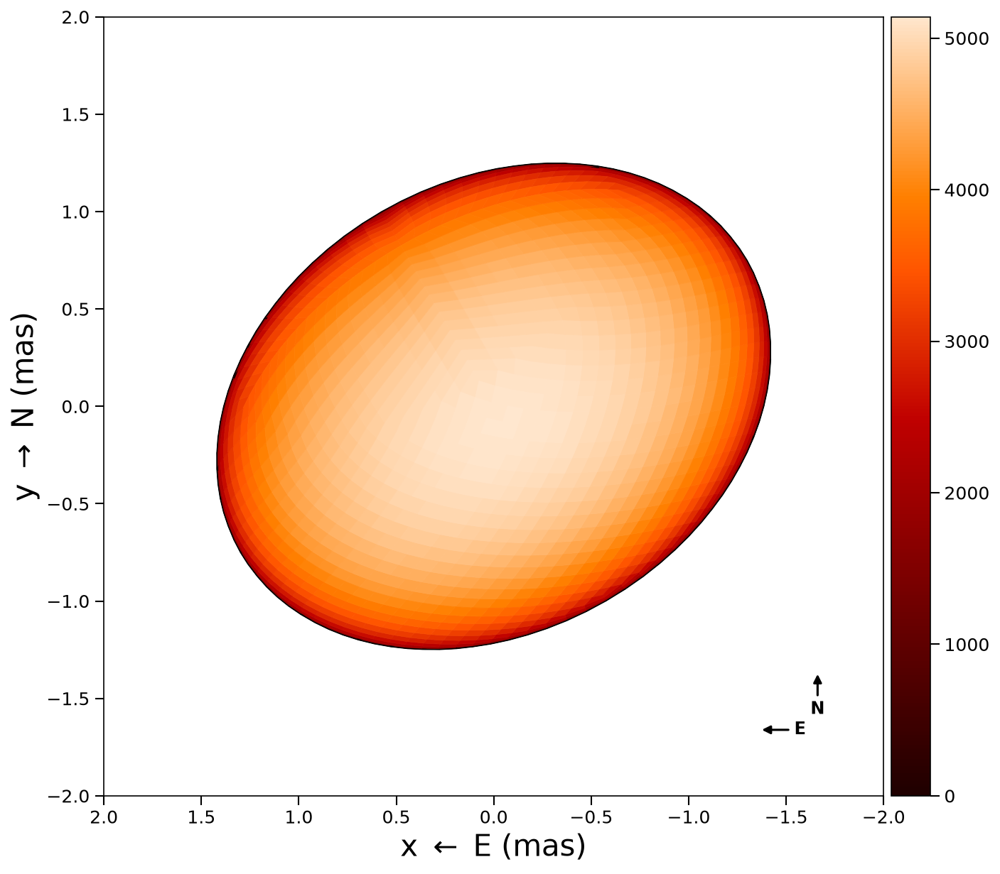
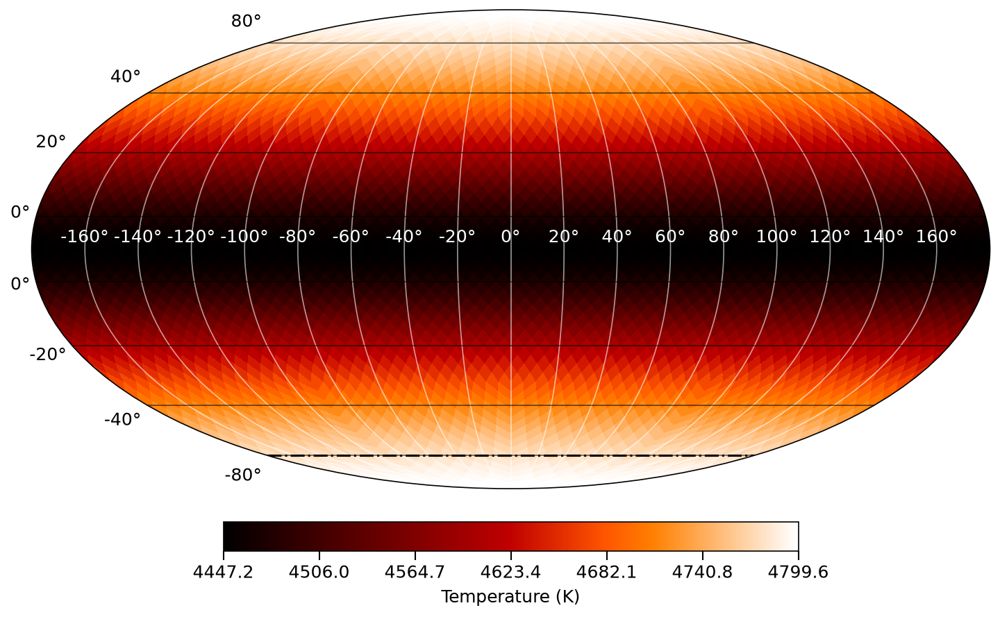

# Plotting

The functions on this page draw with matplotlib and need `using PythonPlot`. Makie versions
(`plot2d_makie`, `plot3d_makie`, `plot_mollweide_makie`) need `using CairoMakie` or `GLMakie`.

## 2D projection

The temperature map as seen by the observer at one epoch:

```julia
plot2d(tmap, stars[1])
```

Keywords, with their defaults:

```julia
plot2d(tmap, stars[1];
    intensity      = false,       # plot intensity (temperature × limb darkening)
    plotmesh       = false,       # pixel edges
    colormap       = "gist_heat",
    figtitle       = "",
    flipx          = false,       # flip East-West
    background     = "white",     # or "black"
    vmin           = nothing,
    vmax           = nothing,
    compass        = true,        # N/E arrows
    graticules     = false,       # lat/lon lines on the surface
    rotation_axis  = false,       # dashed line through the poles
    rotation_arrow = false,       # spin-direction arrow at the north pole
    star_params    = nothing,     # exact surface for the graticules
    graticule_kwargs = (;),       # graticule style (below)
)
```

The axes are the sky plane in milliarcseconds, East left, North up. Only pixels with positive
visibility weight are drawn.

### Temperature contours

Contour lines at the given temperatures:

```julia
plot2d(tmap, stars[1];
    contours       = [3000, 3500, 4000, 4200],       # temperature levels (K)
    contour_color  = "gray",     # line and label color (default "gray")
    contour_labels = true,       # label each contour with "XXXX K" (default true)
    contour_fontsize = 10,       # label font size (default 10)
)
```



### Graticules

`graticules = true` draws latitude/longitude lines on the surface. With `star_params` they
follow the exact surface:

- Sphere (type 0): `radius`
- Triaxial ellipsoid (type 1): `radius_x`, `radius_y`, `radius_z`
- Rapid rotator (type 2): `rpole` and `frac_escapevel`; meridians follow the Roche profile
  (`f_rapid_rot`)

Otherwise they use an oblate spheroid fitted to the mesh vertices.

Style, through `graticule_kwargs`:

```julia
plot2d(tmap, star;
    graticules = true,
    star_params = star_params,
    graticule_kwargs = (
        nlat      = 8,        # number of latitude circles (default 5)
        nlon      = 12,       # number of longitude lines (default 8)
        color     = "white",  # line color (default "black")
        linewidth = 0.6,      # line width (default 0.8)
        alpha     = 0.4,      # opacity (default 0.5)
    ),
)
```

The rotation angle is `360 · star.t / star_params.rotation_period`, so the graticules turn
with the surface.



### Decorations

- Limb (`limb = true`, default): outline of the projected disc (`limb_color`,
  `limb_linewidth`). It keeps a pale surface visible on a white background.
- Pole line (`rotation_axis = true`): dashed line through the projected rotation axis, with
  an arrow at the north pole.
- Spin arrow (`rotation_arrow = true`): curved arrow beyond the north pole showing the sense
  of rotation, reversed when `rotation_period < 0`. The near-side arc is solid, the far side
  dashed.
- Compass (`compass = true`, default): E/N arrows in the lower-right corner, East left.

```julia
plot2d(tmap, star;
    rotation_axis  = true,
    rotation_arrow = true,
    compass        = true,
    limb           = true,   # outline the disc (default)
)
```

The decorations take their orientation from the mesh. `inclination` and `position_angle`
override it:

```julia
plot2d(tmap, star; rotation_axis = true,
       inclination = 60.0, position_angle = 30.0)   # degrees from LOS; N through E
```

!!! warning "Not for binary components"
    A component built by `create_binary_geometry` is oriented by the orbit's `binary_frame`,
    not by its own `inclination` / `position_angle`. Do not pass those to `plot2d_binary`.

| Pole line | Spin arrow | Compass | All three |
|:---------:|:----------:|:-------:|:---------:|
|  |  |  |  |

## Multi-epoch 2D

All epochs side by side, on one colour scale:

```julia
plot2d_allepochs(tmap, stars)
```

```julia
plot2d_allepochs(tmap, stars;
    plotmesh = false,
    tepochs  = tepochs,       # epoch labels
    colormap = "gist_heat",
    ncols    = 3,             # columns; rows and figure size follow
    compass  = true,
)
```

Without `ncols`, the layout is chosen from the number of epochs, up to four across.
`arr_box = 23` gives 2 rows × 3 columns.

## Wireframe

The tessellation alone, without colour fill:

```julia
plot2d_wireframe(stars[1])
```

By default the far side is drawn too, in a lighter colour:

```julia
plot2d_wireframe(stars[1];
    hidden       = true,          # far side as well
    front_color  = "black",       # near side
    hidden_color = "lightgrey",   # far side
    linewidth    = 0.5,
)
```

`hidden = false` draws the near side only.


## 3D surface

The star as a 3-D surface coloured by temperature:

```julia
plot3d(tmap, stars[1])
```

## Mollweide projection

The whole surface in Mollweide (equal-area) projection:

```julia
plot_mollweide(tmap, stars[1])
```

HEALPix and lon/lat meshes are both handled. Keywords:

```julia
plot_mollweide(tmap, stars[1];
    visible_pixels  = [],            # pixels observed at some epoch
    mask_unobserved = true,          # grey out the others
    bad_color       = "lightgray",   # their colour
    vmin            = 4000.0,
    vmax            = 5000.0,
    colormap        = "gist_heat",
    incl            = 78.0,          # dash-dot line at latitude −incl (none at 90)
    title           = "Mollweide",   # axes title
    lon_color       = "white",       # meridians and their labels
    lat_color       = "black",       # parallels and their labels
)
```

The graticule (spacing, line style), degree labels, colourbar (label, tick count), and a
solid equator and central meridian can each be turned off or restyled; see
[Controlling the furniture](@ref). `title` is the axes title. On a HEALPix mesh `figtitle` names
only the figure window; on a lat/long mesh it is also the axes title.

With `visible_pixels` and `mask_unobserved = true`, pixels never observed are drawn in
`bad_color`. `sometimes_visible(stars)` lists the pixels visible at some epoch:

```julia
vis = sometimes_visible(stars)
plot_mollweide(tmap, stars[1], visible_pixels=vis)
```

Longitude runs from −180° to 180° and latitude from −90° to 90°. Meridians are every 20°
(`lon_spacing`), parallels every 15° (`lat_spacing`).


