# Surface types

Four surface geometries, selected by `surface_type`. Each has its own radius profile and
gravity-darkened temperature map.

## Sphere (`surface_type = 0`)

A sphere of radius `radius`.

```julia
star_params = (
    surface_type    = 0,
    radius          = 1.0,      # angular radius (mas)
    tpole           = 5000.0,   # temperature (K)
    ldtype          = 3,        # power-law limb darkening
    ld1             = 0.23,
    ld2             = 0.0,
    inclination     = 60.0,     # degrees
    position_angle  = 30.0,     # degrees
    rotation_period = 10.0,     # days
)
```

The parametric temperature map of a sphere is `tpole` everywhere.

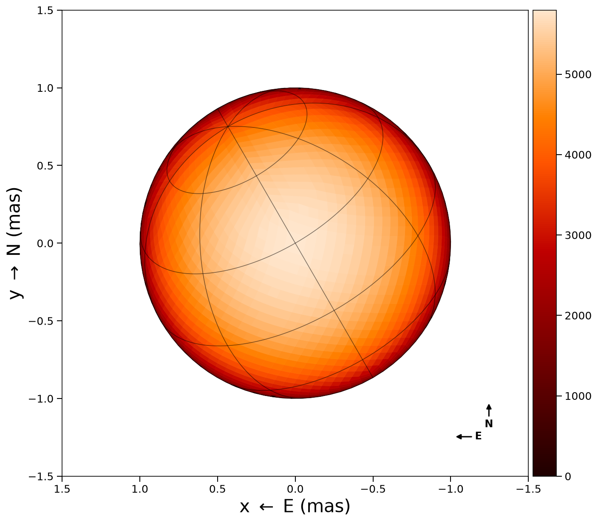

## Triaxial ellipsoid (`surface_type = 1`)

Three semi-axes `radius_x`, `radius_y`, `radius_z`, for a distorted star without a physical
model of the distortion.

```julia
star_params = (
    surface_type    = 1,
    radius_x        = 1.5,     # semi-axis along x (mas)
    radius_y        = 1.3,     # semi-axis along y (mas)
    radius_z        = 1.1,     # semi-axis along z (mas)
    tpole           = 4800.0,
    ldtype          = 3,
    ld1             = 0.23,
    ld2             = 0.0,
    inclination     = 78.0,
    position_angle  = 24.0,
    rotation_period = 54.8,
    beta            = 0.08,    # gravity-darkening exponent
)
```

`temperature_map_vonZeipel_ellipsoid` takes the local gravity as `g ∝ 1/r²` and normalises it
at `r = radius_x`: `T = tpole · (radius_x / r)^(2β)`.

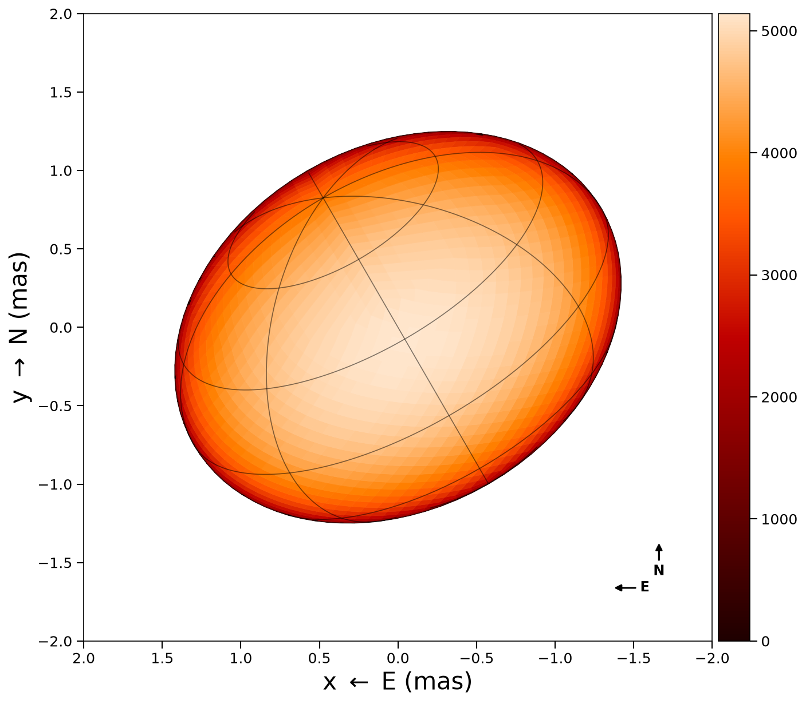

## Rapid rotator (`surface_type = 2`)

A centrifugally distorted star: the Roche equipotential of a rigidly rotating point mass. The
shape depends on the polar radius `rpole` and on `frac_escapevel`, the angular velocity as a
fraction of critical, `Ω/Ω_crit` with `Ω_crit = √(8GM / 27 R_pole³)` (0 to 1):

```
r(theta) = rpole * f(omega * sin(theta))
```

where `f(x) = 3*cos((pi + acos(x))/3) / x`, `theta` is the colatitude and
`omega = frac_escapevel`. At `omega = 0` the star is a sphere (`f = 1`); at `omega = 1`,
critical rotation, `R_eq = 1.5 R_pole`.

```julia
star_params = (
    surface_type    = 2,
    rpole           = 1.37,    # polar radius (mas)
    tpole           = 4800.0,  # polar temperature (K)
    ldtype          = 3,
    ld1             = 0.23,
    ld2             = 0.0,
    inclination     = 78.0,
    position_angle  = 24.0,
    rotation_period = 54.8,
    beta            = 0.08,    # gravity darkening, T ∝ g^β (0.25 radiative, 0.08 convective)
    frac_escapevel  = 0.9,     # Ω/Ω_crit: 0 no rotation, 1 critical
    B_rot           = 0.0,     # differential rotation (0 = solid body)
)
```

With the von Zeipel law (the default) the temperature map is

```
T_eff(theta) = T_pole * (g(theta) / g_pole)^beta
```

with the effective gravity (gravitational plus centrifugal, `GM = 1`,
`Ω = omega · Ω_crit`):

```
g_r     = -GM/r^2 + r * (Ω * sin(theta))^2
g_theta = Ω^2 * r * sin(theta) * cos(theta)
g       = sqrt(g_r^2 + g_theta^2)
```

Reference values for `beta`: 0.25 for radiative envelopes (von Zeipel 1924), 0.08 for
convective envelopes (Lucy 1967). Claret (2000) gives `beta` as a function of effective
temperature and evolutionary stage. The equator-to-pole ratios for each `frac_escapevel` are
in the table of the next section.

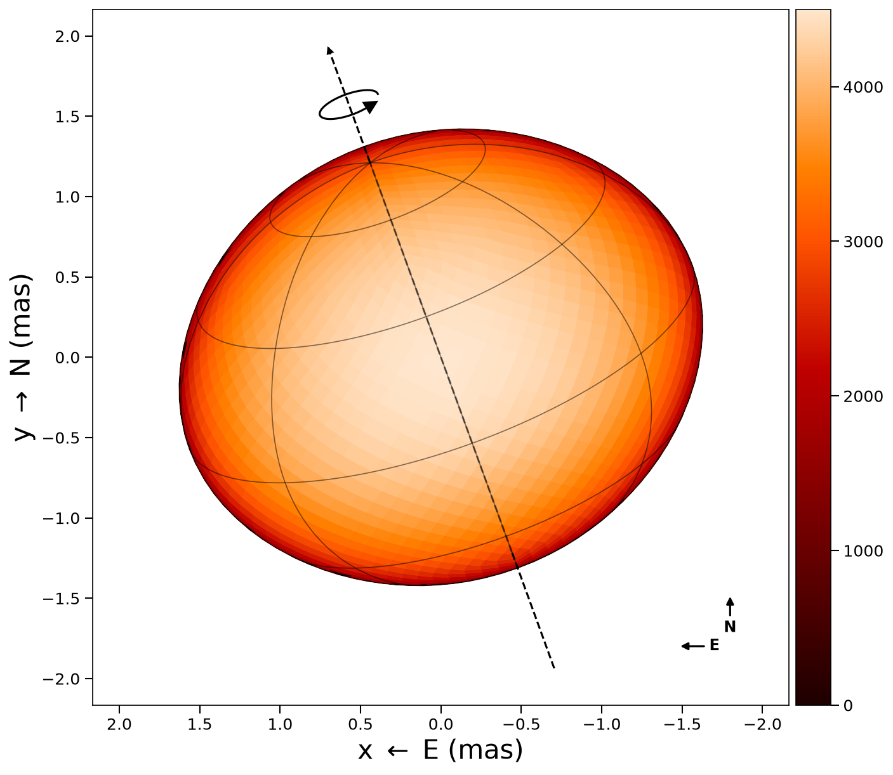

### Choosing a gravity-darkening law

von Zeipel's law assumes a barotropic star, which is incompatible with radiative equilibrium
under rotation; it overestimates the pole-to-equator contrast of a fast rotator. Espinosa Lara
& Rieutord (2011, A&A 533, A43) assume instead that the radiative flux is anti-parallel to the
effective gravity (true to within half a degree up to break-up), which adds a latitudinal flux
factor. `gravity_law` selects the law:

```julia
rapid_rotator = (
    surface_type    = 2,
    frac_escapevel  = 0.95,
    beta            = 0.25,
    gravity_law     = :elr,    # or :vonzeipel (default); codes 2 and 1
    # ... the rest as above
)
```

`omega` here is ELR's `Ω/Ω_K` at the equator:

| frac_escapevel | omega | R_eq/R_p | T_eq/T_p von Zeipel | T_eq/T_p ELR | ELR warmer |
|------|-------|------|-------|-------|-------|
| 0.00 | 0.000 | 1.00 | 1.000 | 1.000 |  0.0 % |
| 0.50 | 0.289 | 1.04 | 0.958 | 0.961 |  0.2 % |
| 0.70 | 0.437 | 1.10 | 0.906 | 0.916 |  1.1 % |
| 0.90 | 0.657 | 1.22 | 0.788 | 0.831 |  5.5 % |
| 0.95 | 0.750 | 1.28 | 0.719 | 0.789 |  9.8 % |
| 0.99 | 0.883 | 1.39 | 0.581 | 0.713 | 22.6 % |

Below `frac_escapevel ≈ 0.5` the two laws differ by less than an interferometer can measure.
Above it, use ELR, or fit both and compare evidences: the laws have the same parameters, so
the log-evidence difference (`fit_parametric_ultranest`, or Nautilus in the GUI) is their
Bayes factor.

`beta` is a free parameter under both laws. ELR's published law has `beta = 0.25` (grey
radiative atmosphere); fix `beta` at 0.25 to reproduce it.

Gravity and limb darkening both remove flux from the limb. Fitting von Zeipel to a fast
rotator demands too much pole-to-equator contrast, and the limb-darkening coefficients absorb
the difference: a negative fitted coefficient on a rapid rotator suggests trying ELR.

#### References

The two implemented laws:

- von Zeipel, H. 1924, *The radiative equilibrium of a rotating system of gaseous masses*,
  MNRAS **84**, 665. [doi:10.1093/mnras/84.9.665](https://doi.org/10.1093/mnras/84.9.665)
- Espinosa Lara, F. & Rieutord, M. 2011, *Gravity darkening in rotating stars*,
  A&A **533**, A43.
  [doi:10.1051/0004-6361/201117252](https://doi.org/10.1051/0004-6361/201117252). Eq. (31) is
  the law, eq. (24) its auxiliary angle, eq. (32) the equator-to-pole ratio the implementation
  is tested against.

Not implemented:

- Espinosa Lara, F. & Rieutord, M. 2012, *Gravity darkening in binary stars*,
  A&A **547**, A32.
  [doi:10.1051/0004-6361/201219942](https://doi.org/10.1051/0004-6361/201219942). The same
  law in a two-body Roche potential (would apply to `surface_type = 3`).
- Zorec, J., Rieutord, M., Espinosa Lara, F., et al. 2017, *Gravity darkening in stars
  with surface differential rotation*, A&A **606**, A32.
  [doi:10.1051/0004-6361/201730818](https://doi.org/10.1051/0004-6361/201730818). Would need
  a new shape model as well as a new temperature map.

Exponent values: Lucy, L. B. 1967 (Z. Astrophys. **65**, 89) for convective envelopes;
Claret, A. 2000 for the dependence on effective temperature and evolutionary state.

### Oblateness progression

`frac_escapevel` from 0 to near-critical:

| 0.0 | 0.5 | 0.9 | 0.99 |
|:-----------:|:-----------:|:-----------:|:------------:|
| 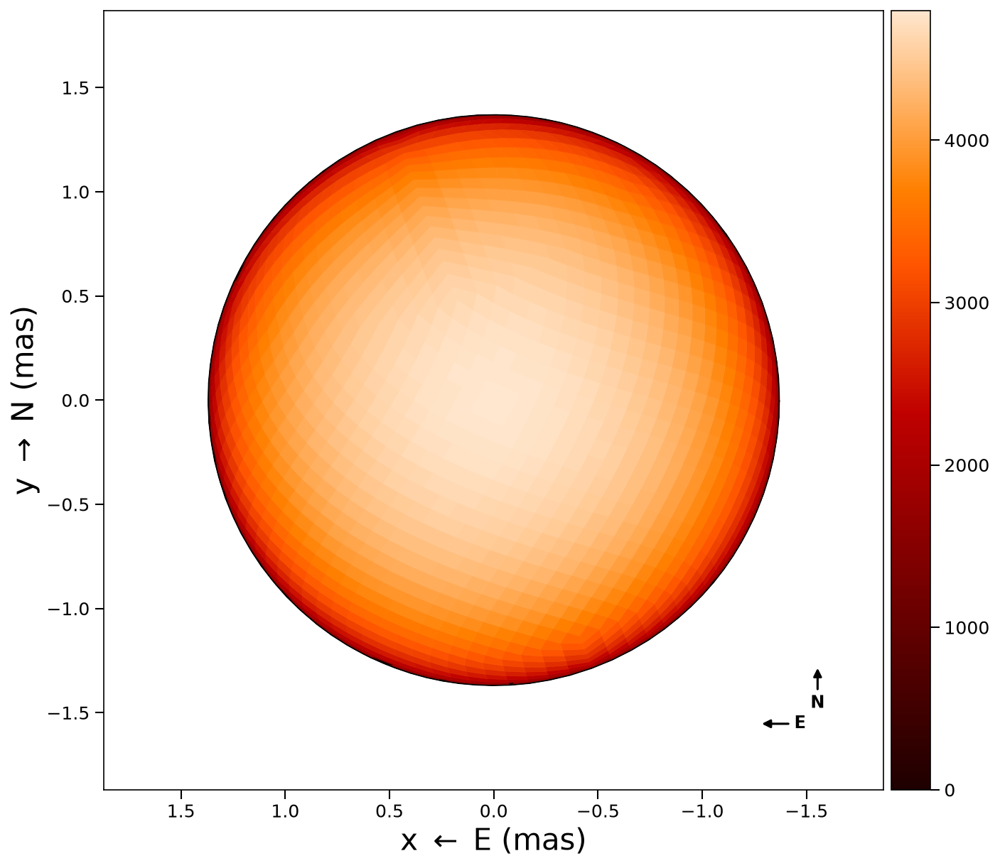 | 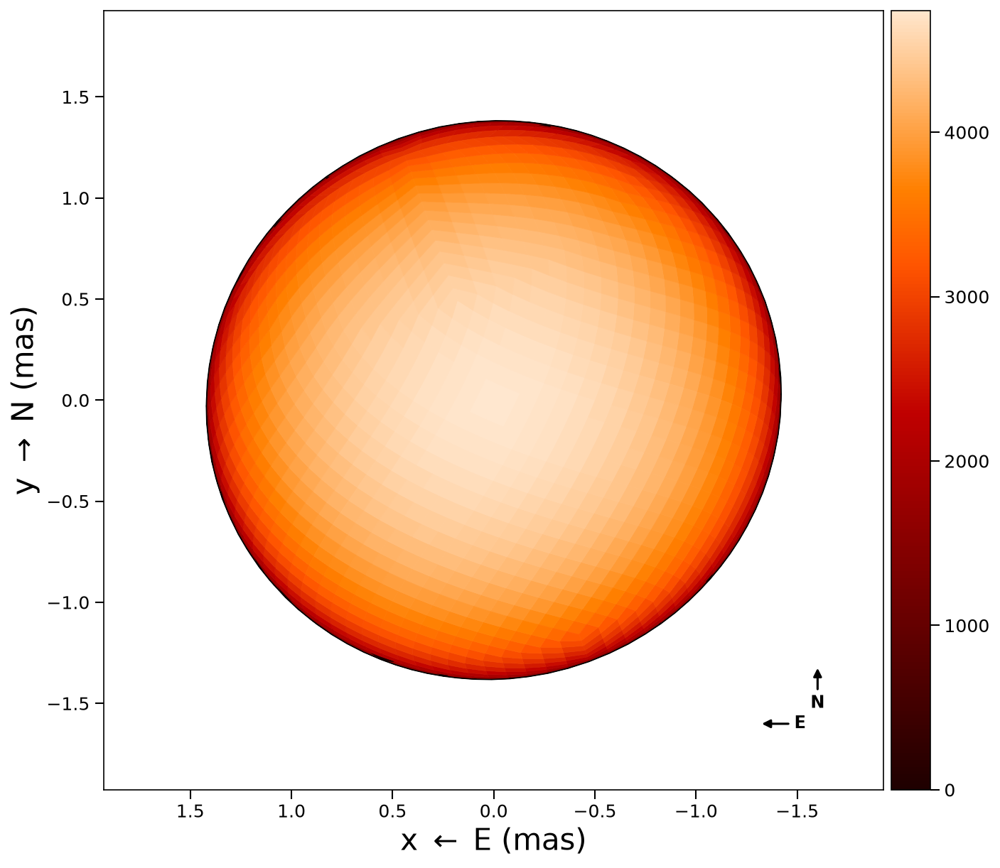 |  | 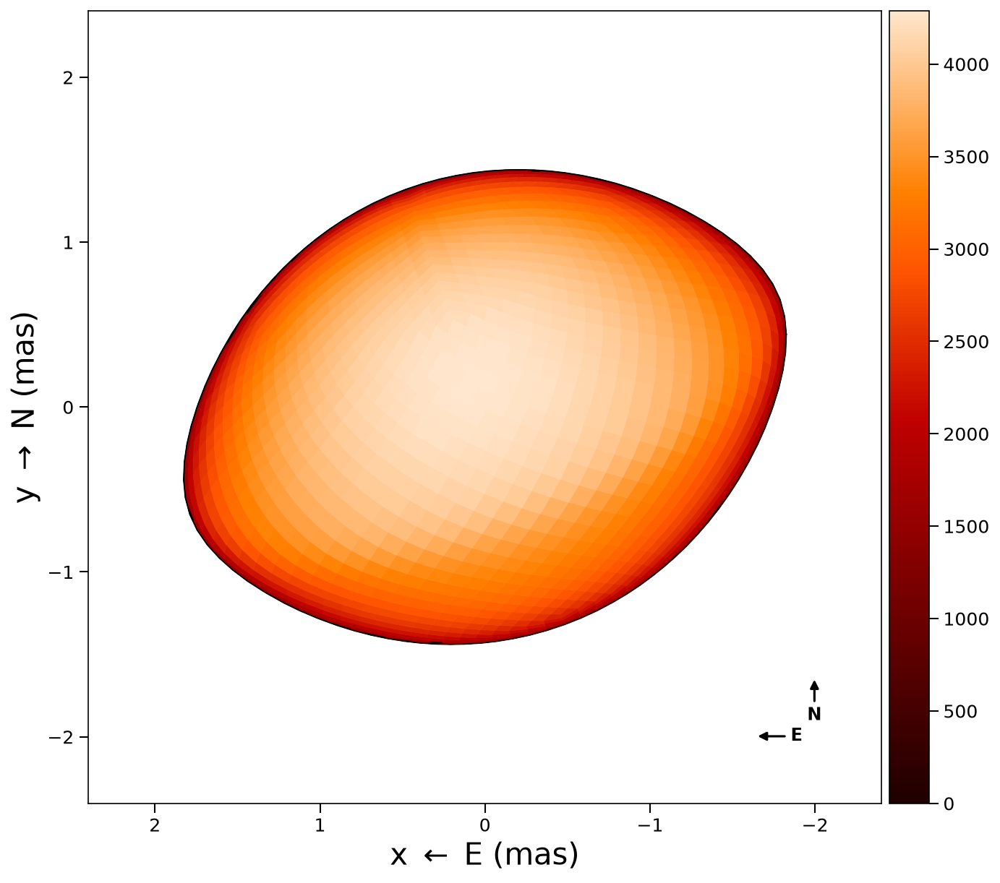 |

### Helper functions

- `oblate_const(star_params)`: semi-axes `(a, b, c)` of the oblate spheroid with the same
  equatorial and polar radii
- `calc_omega(rpole, oblateness)`: fractional angular velocity from the oblateness
  `R_eq/R_pole − 1`; returns `(omega, rpole, R_equ)`
- `calc_rotspin(rpole, R_equ, omega, Mass)`: returns `(rotational_vel, rotation_period)`,
  the period in days (`rpole`, `R_equ` in solar radii, `Mass` in solar masses)

## Roche lobe (`surface_type = 3`)

A binary component filling or nearly filling its Roche lobe. The shape follows from the
binary potential, the mass ratio and the separation.

```julia
roche_params = (
    surface_type   = 3,
    rpole          = 0.355,   # polar radius (mas)
    tpole          = 4800.0,
    ldtype         = 3,
    ld1            = 0.23,
    ld2            = 0.0,
    inclination    = 0.0,
    position_angle = 0.0,
    rotation_period = 5.0,
    beta           = 0.08,
    # Binary / Roche parameters
    d              = 77.0,     # distance (parsecs)
    q              = 1.0,      # mass ratio M2/M1
    fillout_factor_primary = -1, # -1: rpole sets the potential
    # Orbital elements (Unicode Ω, ω, dω)
    i  = 0.0,     # orbital inclination (degrees)
    Ω  = 0.0,     # longitude of ascending node (degrees)
    ω  = 0.0,     # argument of periapsis (degrees)
    P  = 5.0,     # orbital period (days)
    a  = 1.0,     # semi-major axis (mas)
    e  = 0.0,     # eccentricity
    T0 = 0.0,     # time of periastron, in the epochs' time system
    dP = 0.0,     # period derivative (days/day)
    dω = 0.0,     # apsidal motion (degrees/day)
)
```

The radius `r(theta, phi)` at each vertex is found by solving the Roche potential with
Halley's method.

### Fillout factor vs. polar radius

The surface potential is set by one of:

1. `rpole`, with `fillout_factor_primary = -1`.
2. `fillout_factor_primary > -1`: the fill-out factor (Mochnacki 1984 definition); 1 fills
   the Roche lobe.

Conversions:
- `ROTIR.fillout_to_rpole(fillout, D, q, async_ratio)`
- `rpole_to_fillout(rpole, D, q, async_ratio)`
- `max_rpole(D, roche_parameters)`: polar radius of the lobe-filling surface

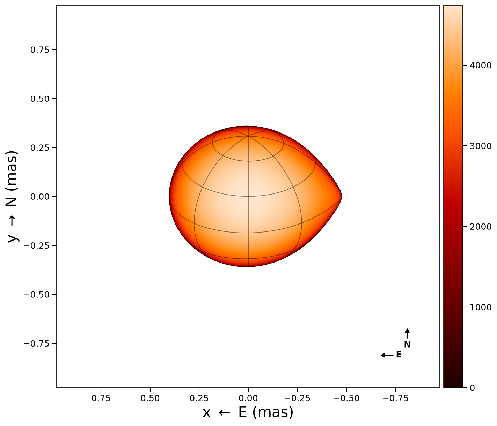

`draw_graticules` interpolates the mesh's `r(θ, φ)`, so the graticule follows the Roche shape
out to the tidal point. See [Plotting](../api/plotting.md).

### Fillout factor progression

Fill-out factor from 0.90 to 0.99:

| 90% | 95% | 98% | 99% |
|:---:|:---:|:---:|:---:|
| 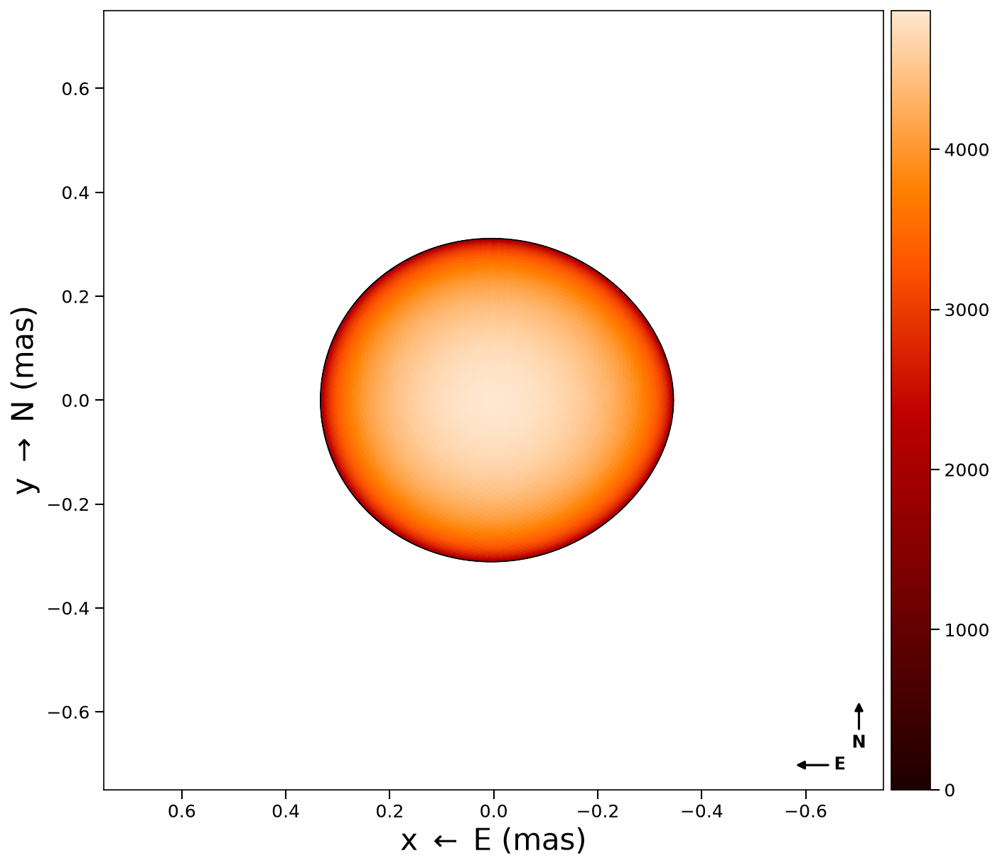 | 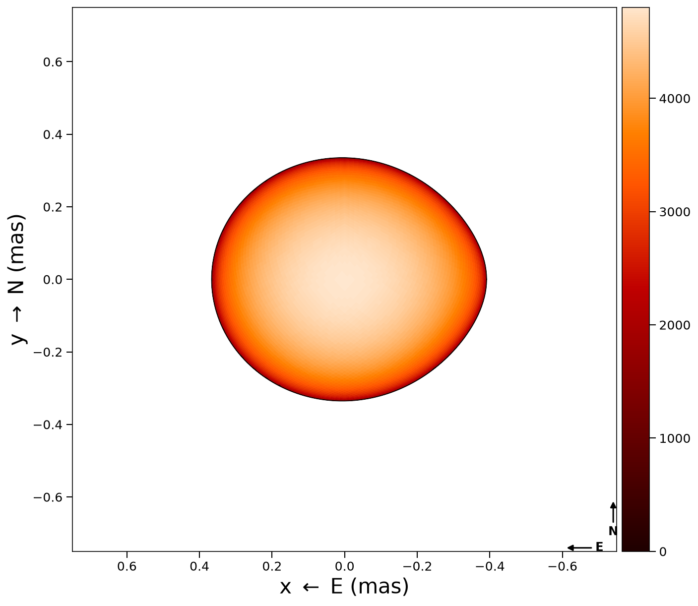 | 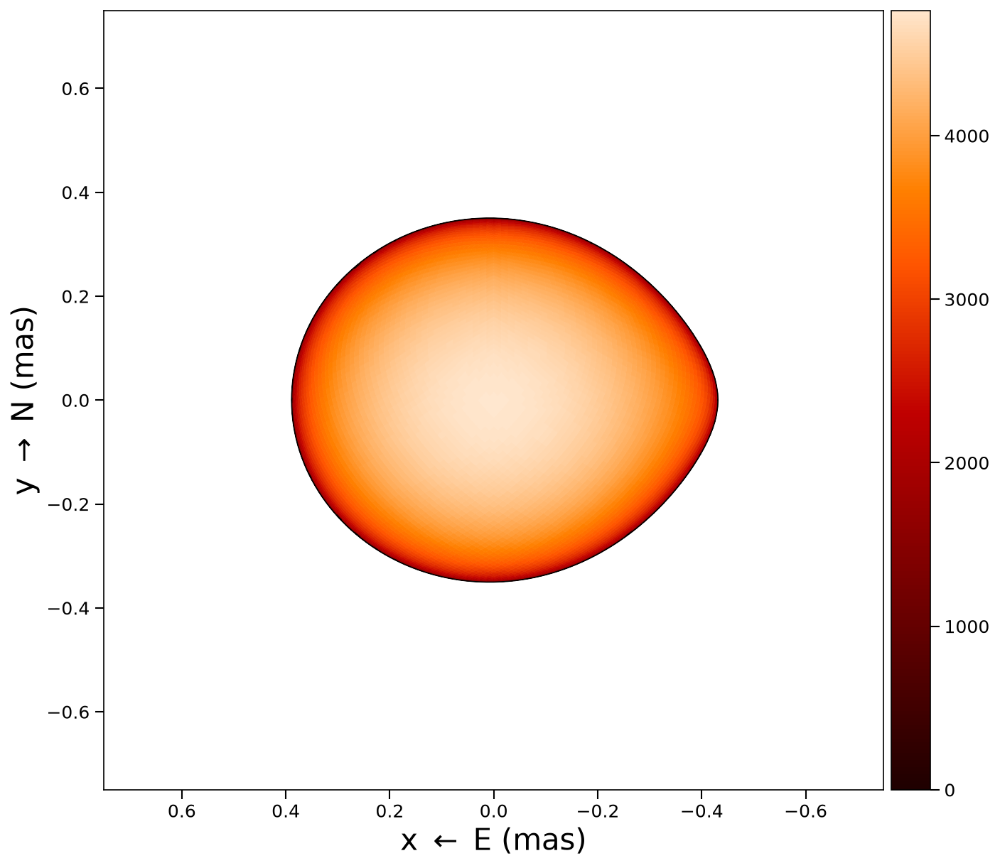 | 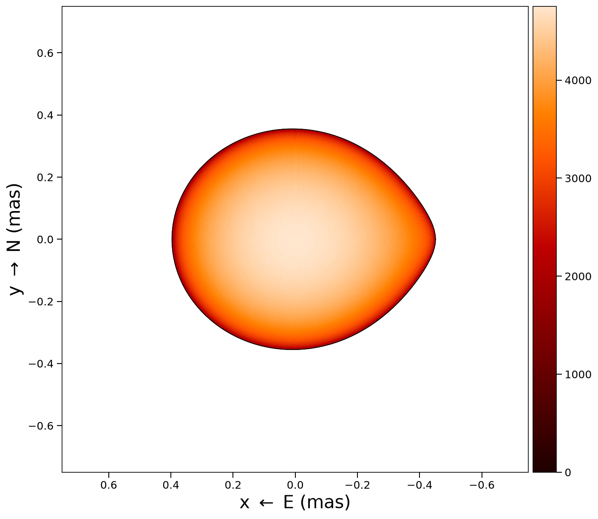 |

### Roche lobe radius estimates

- `radius_eggleton(q)`: Eggleton (1983) volume-equivalent lobe radius, `r_L/a`
- `radius_leahy(q)`: Leahy & Leahy (2015) approximation

## Temperature maps

`parametric_temperature_map` gives the gravity-darkened map for any surface type:

```julia
stars = create_star_multiepochs(tessels, star_params, tepochs)
tmap = parametric_temperature_map(star_params, stars[1])
```

By `surface_type`:
- 0: `tpole` everywhere
- 1: `temperature_map_vonZeipel_ellipsoid`
- 2: `temperature_map_rapid_rotator` (von Zeipel or ELR, by `gravity_law`)
- 3: `temperature_map_vonZeipel_roche_single`

## Limb darkening

`ldtype` selects the law:

| `ldtype` | Law | Formula |
|----------|-----|---------|
| 0 | none | `I/I_0 = 1` (for model-atmosphere intensities, which include limb darkening) |
| 1 | linear | `I/I_0 = 1 - ld1*(1 - mu)` |
| 2 | quadratic | `I/I_0 = 1 - ld1*(1 - mu) - ld2*(1 - mu)^2` |
| 3 | power law (Hestroffer) | `I/I_0 = mu^ld1` |
| 4 | Claret four-parameter | `I/I_0 = 1 - ld1*(1 - mu^½) - ld2*(1 - mu) - ld3*(1 - mu^{3/2}) - ld4*(1 - mu^2)` |

`mu` is the cosine of the angle between the surface normal and the line of sight.
