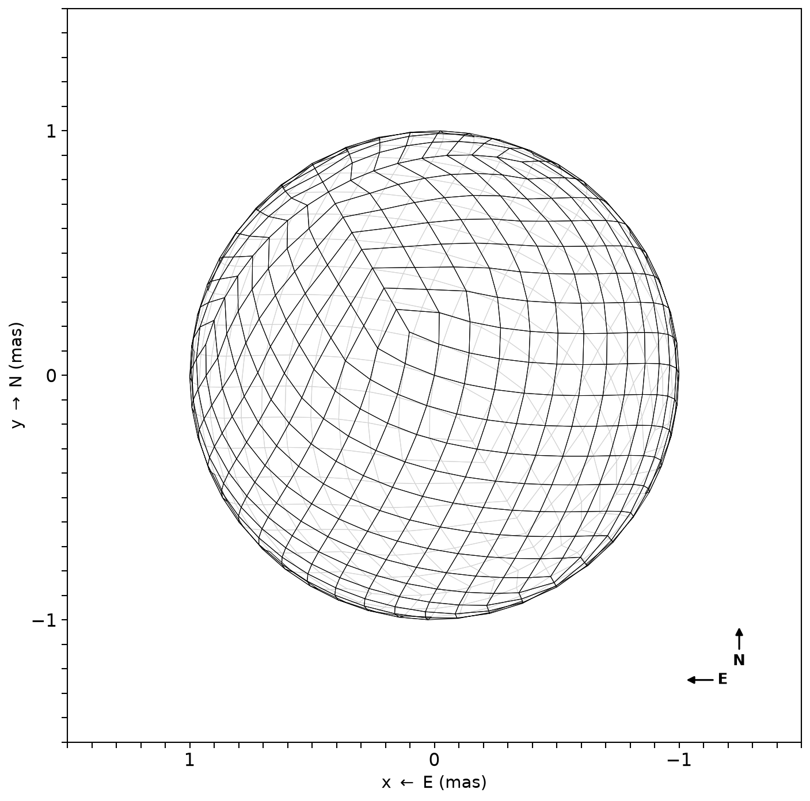
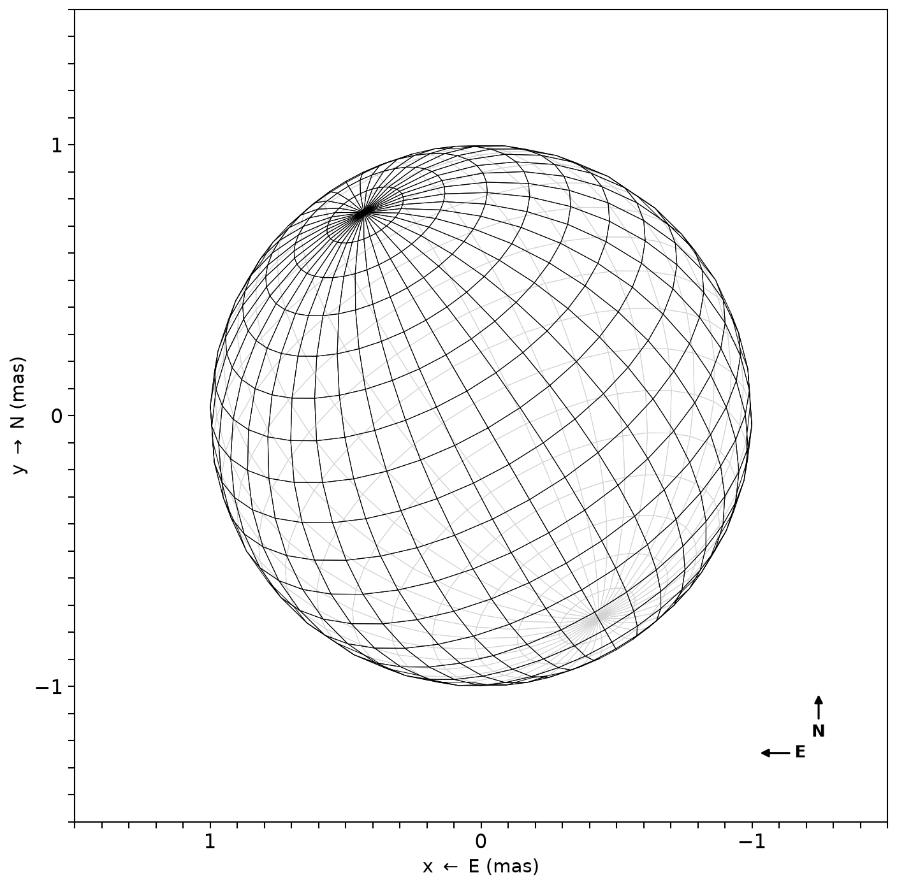
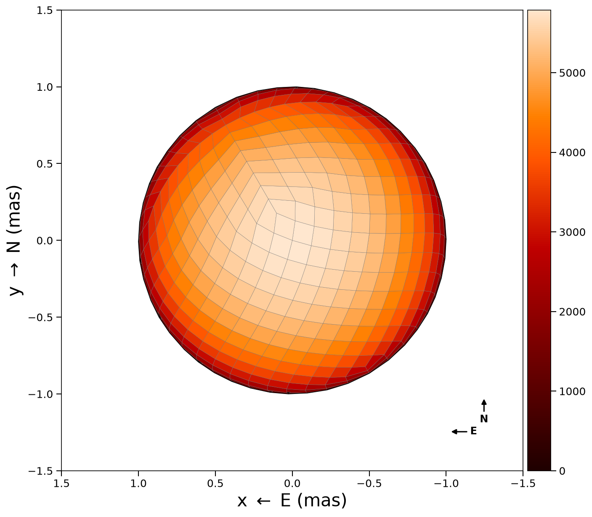
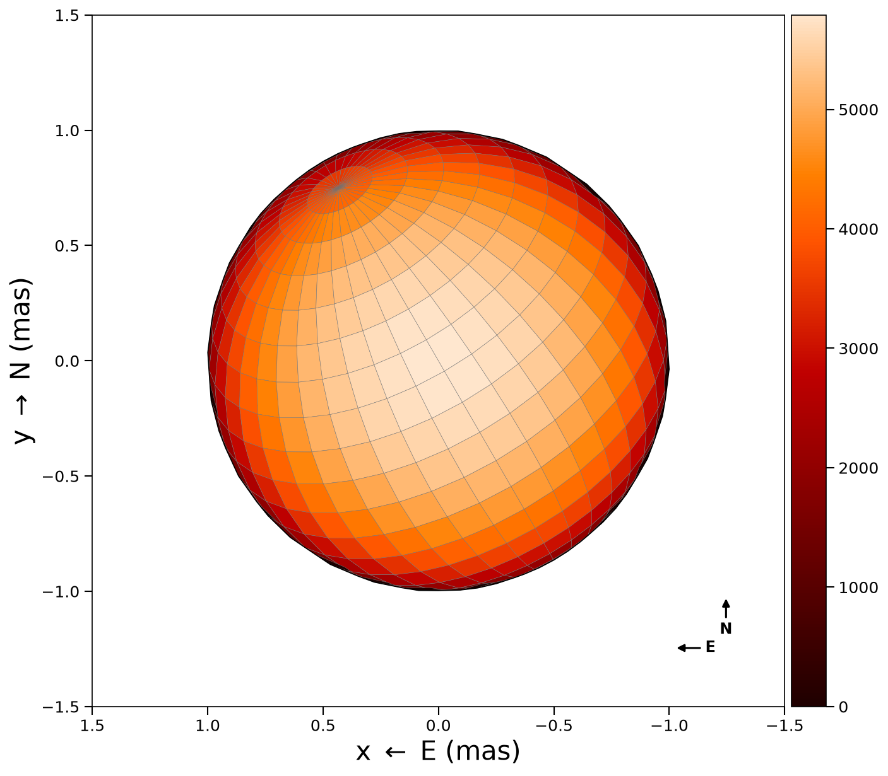
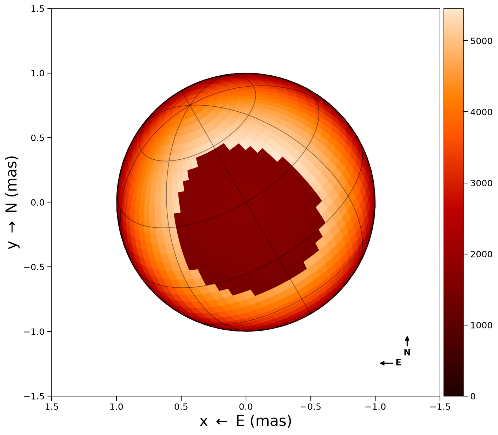
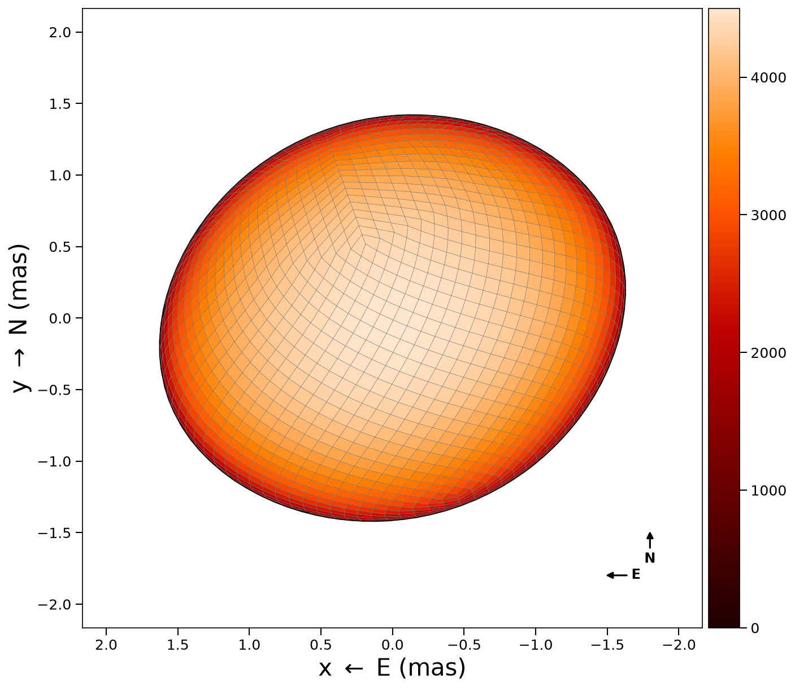

# Tessellation

ROTIR divides the stellar surface into quadrilateral pixels, with one of two schemes.

## HEALPix scheme (nested ordering)

HEALPix (Hierarchical Equal Area isoLatitude Pixelization) divides the sphere into
equal-area pixels. ROTIR uses the nested ordering, a quad-tree: each pixel at level n has
4 children at level n+1, which is what multi-resolution reconstruction uses.

```julia
n = 3                                   # resolution parameter
tessels = tessellation_healpix(n)       # nside = 2^n = 8, npix = 768
```

Pixel counts:

| `n` | nside | npix | Typical use |
|-----|-------|------|-------------|
| 1 | 2 | 48 | Quick tests |
| 2 | 4 | 192 | Low resolution |
| 3 | 8 | 768 | Standard reconstruction |
| 4 | 16 | 3072 | High resolution |
| 5 | 32 | 12288 | Very high resolution |

`nside2npix(nside)` returns `12 * nside^2`; `npix2n(npix)` returns `n`.

### Pixel structure

Each pixel has 5 points: 4 corners and the centre (index 5).

- `tessels.unit_xyz`: Cartesian coordinates on the unit sphere, `(npix, 5, 3)`
- `tessels.unit_spherical`: `(r, theta, phi)`, `(npix, 5, 3)`

`theta` is the colatitude (0 at the north pole, π at the south pole), `phi` the longitude.

### Visual comparison

HEALPix at n=3 (768 pixels) and a longitude/latitude grid (20×40 = 800 pixels):

| HEALPix (nested, n=3) | Lon/Lat (20x40) |
|:----------------------:|:---------------:|
|  |  |

Pixel edges on a limb-darkened sphere:

| HEALPix (nested, n=3) | Lon/Lat (20x40) |
|:----------------------:|:---------------:|
|  |  |

### Neighbors, gradients and total variation

HEALPix pixels have 8 neighbours (6 or 7 at a few locations). The regularisers use three
operators built on them.

Gradient (`"sobel"`, `"sobel2"`):

```julia
sobel_info = sobel_gradient_healpix(n)
```

Returns `(; Gx, Gy, D, owner, npix, area)`. `Gx` and `Gy` are sparse matrices giving the
tangent-plane components of ∇x at each tessel: the inverse-distance²-weighted least-squares
gradient (the 2-D Sobel stencil) on irregular neighbourhoods. `D` is what the regularisers
penalise: the same neighbours and weights, each difference squared before summing; its only
null mode is the constant map.

Cotangent Laplace–Beltrami (`"laplace_beltrami"`):

```julia
lb_info = laplace_beltrami_healpix(n)
```

Returns `(; D, npix, area, nedges)`: one row per edge of the triangulation of the tessel
centres (each four-tessel corner split along its Delaunay diagonal), with cotangent weights.
`‖D x‖²` converges to `∫|∇x|²dΩ` at second order, the most resolution-independent of the
three.

Graph Laplacian (`"tv"`, `"tv2"`):

```julia
tv_info = tv_neighbors_healpix(n)
```

Returns a tuple whose last two entries are the sparse graph Laplacian and its Hessian. To
regularise only pixels visible at some epoch:

```julia
tv_info = tv_neighbors_healpix_visible(n, stars)
```

## Longitude/latitude scheme

A regular grid in colatitude and longitude:

```julia
ntheta = 50                                     # latitude rings
nphi = 50                                       # pixels per ring
tessels = tessellation_latlong(ntheta, nphi)     # npix = 2500
```

Every ring has `nphi` pixels, `ntheta * nphi` in total, over colatitude `[0, π)` and
longitude `[0, 2π)`.

Neighbours for `"tv"`/`"tv2"`:

```julia
tv_info = tv_neighbors_longlat(ntheta, nphi)
```

### Spots

Any tessellation, from a star geometry:

```julia
tmap = make_circ_spot(tmap, star_geometry, spot_radius, lat, long;
                       bright_frac=0.8)
```

- `spot_radius` in degrees, `lat` in \[-90, 90\], `long` in \[-180, 180\] or \[0, 360\]
- Distances are 3-D chord lengths, so spots stay circular on non-spherical surfaces
- `make_circ_spot_spotfill(star_geometry, spot_radius, lat, long; profile="flat")` returns
  the fill fraction per pixel; `profile` is `"flat"` or `"linear"` (decreasing toward the edge)

Lon/lat grid only, by pixel index:

```julia
tmap = make_circ_spot(tmap, ntheta, nphi, spot_radius, latitude, longitude;
                       bright_frac=0.8)
tmap = make_spot_move(tmap, ntheta, nphi, period, B_rot, tepochs)
```

A cool spot from `make_circ_spot` on a lon/lat sphere:



### Resolution levels

HEALPix levels on a rapid rotator, pixel edges shown:

| n=2 (192 px) | n=3 (768 px) | n=4 (3072 px) |
|:------------:|:------------:|:-------------:|
|  |  |  |

## Choosing a scheme

| Feature | HEALPix | Lon/Lat |
|---------|---------|---------|
| Equal area pixels | Yes | No (poles oversampled) |
| Multi-resolution | Yes (factor-of-4 up/downsampling) | No |
| Hierarchical nesting | Yes | No |
| Latitude/longitude interpretation | No | Direct |
| Differential rotation | Manual | Built-in `make_spot_move` |
| Spot creation | `make_circ_spot(tmap, star_geom, ...)` | Also `make_circ_spot(tmap, ntheta, nphi, ...)` |

HEALPix is the scheme to use for reconstruction: equal-area pixels and multi-resolution.
