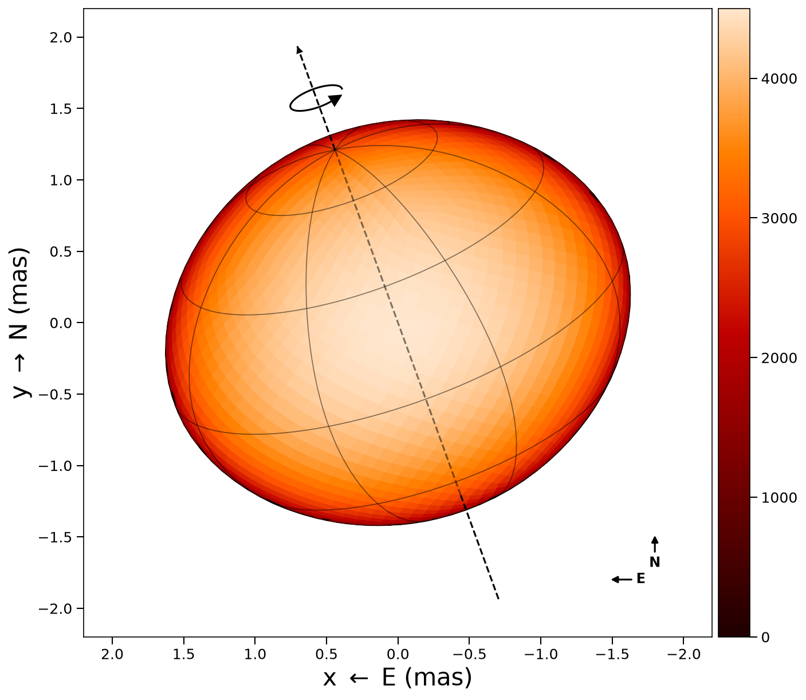

# ROTIR

**ROTIR** is a [Julia](http://julialang.org/) package for regularized imaging of
stellar surfaces from optical interferometry data, developed by
Prof. Fabien Baron (Georgia State University) and collaborators.

ROTIR represents the stellar surface as a tessellated sphere or non-spherical shape and
reconstructs its temperature map from V², closure phases and triple amplitudes.

- Surface geometries: sphere, triaxial ellipsoid, rapid rotator, Roche-lobe-filling star
- Tessellations: HEALPix and longitude/latitude grids
- Multi-epoch reconstruction across rotation phases
- Coarse-to-fine HEALPix reconstruction
- Joint fit of shape (radii, inclination, position angle) and surface map, with analytic gradients
- Regularisers: spherical Sobel, Laplace–Beltrami, graph-Laplacian (`tv`, `tv2`), maximum
  entropy, mean, harmonic bias, radial priors
- Temperature to intensity: Rayleigh–Jeans, Planck, or model atmospheres (Kurucz ATLAS9,
  Korg/MARCS) that predict the limb darkening
- Export to OITOOLS: FITS image cubes (channel × epoch, binaries included) that reproduce
  ROTIR's visibilities

ROTIR uses [OITOOLS.jl](https://github.com/fabienbaron/OITOOLS.jl) for OIFITS
I/O and data handling.

## How it works

The forward model, from surface temperature map to observables:

| Step | Function |
|------|----------|
| 1. Tessellate unit sphere | `tessellation_healpix(n)` or `tessellation_latlong(ntheta, nphi)` |
| 2. Apply surface geometry | `create_star(tessels, star_params, t)` |
| 3. Rotate to observer frame | Euler rotation by (phase, inclination, PA) |
| 4. Project to sky plane | Projected quad vertices `(proj_west, proj_north)` |
| 5. Compute visibility matrix | `setup_oi!(data, stars)` |
| 6. Temperature to observables | `observables(tmap, star, data)` |
| 7. Chi-squared + gradient | `spheroid_chi2_fg(tmap, g, star, data)` |
| 8. Optimize | `image_reconstruct_oi(tmap, data, stars)` |

## Visual examples

A rapid rotator with graticules, spin axis, rotation arrow and compass:

The same star in Mollweide projection:

!!! note

    ROTIR is under active development. The code is being modernized and
    documented progressively.
